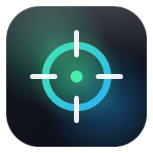
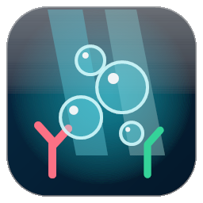
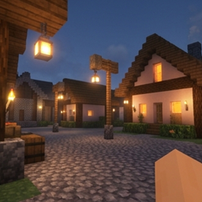
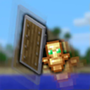
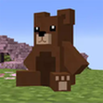
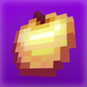

# Horizon Mods & Shaders Catalog (26.3)

Официальный онлайн-каталог для **Horizon Offline Launcher (Minecraft 26.3)**:
**27 нативных WGSL-шейдеров** (`.hshader`) и **30 популярных PvP/Combat ресурс-паков с Modrinth** (`.zip`, прямая загрузка с `cdn.modrinth.com`).
Все дополнения работают **на 100% на стороне клиента** — и в одиночном мире, и на любом сервере.

## Нативные WGSL-шейдеры (27)

| Превью | Название | Файл | Описание |
| :---: | :--- | :--- | :--- |
|  | **Motion Blur** | `motion-blur.hshader` | Плавное размытие в движении для Horizon 26.3 с адаптацией под 144 Гц и настройками силы и качества в игре. |
|  | **Fullbright** | `fullbright.hshader` | Максимальная яркость в пещерах, под водой и ночью без факелов и зелий с сохранением объёма блоков. |
|  | **Vibrant Vanilla+** | `vibrant-vanilla.hshader` | Сочные краски, тёплый солнечный свет на гранях блоков, мягкий контраст и ACES-цветокоррекция без потери FPS. |
|  | **Dynamic Colored Lights** | `colored-lights.hshader` | Реалистичное цветное 3D-освещение от факелов, душ, редстоуна, лавы, аметистов, порталов и морских фонарей. |
|  | **Realistic Water & Reflections** | `water-reflections.hshader` | Зеркальные отражения мира в воде, живые процедурные волны с бликами солнца и чистая глубина водоёмов. |
|  | **Real Shadows Lite** | `real-shadows-lite.hshader` | Мягкие динамические тени от солнца и луны с цветными тенями от витражей, оптимизированные под высокий FPS. |
|  | **Horizon Ultra** | `horizon-ultra.hshader` | Флагманский комбо-шейдер: мягкие тени, зеркальная вода, цветной 3D-свет, атмосферное небо, Bloom и Motion Blur. |
|  | **FPS Sharpness (CAS)** | `fps-sharpness.hshader` | Адаптивная чёткость AMD CAS — убирает «мыло» с текстур вдали без ореолов и практически с 0% нагрузки на видеокарту. |
|  | **Crystal Underwater** | `crystal-underwater.hshader` | Кристально чистая видимость под водой без мутного тумана + красивые солнечные каустики на морском дне. |
|  | **Clear Nether & End** | `clear-nether-end.hshader` | Полностью убирает густой туман в Незере и Энде и слегка подсвечивает тёмные своды для отличного обзора. |
|  | **Aurora & Starry Sky** | `aurora-starry-sky.hshader` | Переливающееся северное сияние и яркая россыпь звёзд с Млечным Путём на ночном небе. |
|  | **Golden Sunset** | `golden-sunset.hshader` | Тёплая кинематографическая атмосфера золотого часа, янтарное свечение солнца, мягкая виньетка и плёночный тон. |
|  | **Cinematic Bloom** | `cinematic-bloom.hshader` | Мягкое кинематографическое свечение ярких источников света — факелов, лавы, порталов, маяков и солнца. |
|  | **Anime Cel-Shading** | `anime-cel-shading.hshader` | Мультяшный стиль в духе аниме и Borderlands: чёткая контурная обводка граней по глубине и ступенчатый свет. |
|  | **Retro PS1 / CRT** | `retro-ps1-crt.hshader` | Атмосфера консолей 90-х: пикселизация, дизеринг палитры 15-bit и мягкие CRT-сканлайны кинескопа. |
|  | **Horror Fog** | `horror-fog.hshader` | Густой холодный туман как в Silent Hill, приглушённые мрачные тона, плёночное зерно и плотная виньетка. |
|  | **Cyberpunk Neon** | `cyberpunk-neon.hshader` | Неоновый киберпанк-стиль: бирюзово-пурпурное освещение, яркие светящиеся блоки и лёгкая хроматическая аберрация. |
|  | **No Fog** | `no-fog.hshader` | Полностью отключает любой туман в Обычном мире, Незере, Энде, под водой и в дождь для 100% видимости вдаль. |
|  | **True Darkness** | `true-darkness.hshader` | Хардкорная реалистичная темнота в пещерах и безлунной ночью — без факела в шахте действительно ничего не видно. |
|  | **Warm Cozy Torchlight** | `warm-torchlight.hshader` | Уютный тёплый янтарный свет от факелов, костров и фонарей с мягким живым мерцанием пламени. |
|  | **Noir Black & White** | `noir-bw.hshader` | Контрастный чёрно-белый фильтр в стиле классического нуар-кино с опцией сохранения ярко-красных акцентов (Sin City). |
|  | **Pastel Dream** | `pastel-dream.hshader` | Мягкая сказочная пастельная цветовая гамма, осветлённые кремовые тени и нежное розово-лавандовое небо. |
|  | **Night Vision & Thermal** | `night-vision-thermal.hshader` | Тактический ПНВ и тепловизор (переключается одной галочкой в настройках шейдера: зелёный ПНВ или ИК-спектр). |
|  | **Depth of Field** | `depth-of-field.hshader` | Кинематографическое размытие фона (боке) с плавным автофокусом по центру прицела. |
|  | **Heat Haze** | `heat-haze.hshader` | Реалистичное марево раскалённого воздуха в пустынях, саваннах, бесплодных землях и в Незере. |
|  | **Blood Moon** | `blood-moon.hshader` | Багровое ночное небо, кроваво-красный ореол вокруг луны и зловещее алое освещение по ночам. |
|  | **PvP Boost Minimal** | `pvp-boost-minimal.hshader` | Киберспортивный PvP-шейдер: мягкий Fullbright, чёткость CAS, отключённый туман и сочный контраст с нулевой потерей FPS. |

## PvP и Combat ресурс-паки с Modrinth (30)

| Иконка | Название | Modrinth | Описание |
| :---: | :--- | :--- | :--- |
|  | **Low On Fire** | [low-on-fire](https://modrinth.com/resourcepack/low-on-fire) | Опускает пламя огня вниз экрана при горении в ванильном стиле — не закрывает обзор в PvP (18M+ скачиваний на Modrinth). |
|  | **Mandala's GUI - Dark mode** | [mandalas-gui-dark-mode](https://modrinth.com/resourcepack/mandalas-gui-dark-mode) | Элегантный тёмный интерфейс для инвентаря, сундуков, верстака и всех меню Minecraft без изменения блоков (7.5M+ скачиваний). |
|  | **Low Shield** | [low-shield-pack](https://modrinth.com/resourcepack/low-shield-pack) | Опускает щит ниже в руке, чтобы он не перекрывал противника и прицел во время боя (6M+ скачиваний). |
|  | **Enhanced Boss Bars** | [enhanced-boss-bars](https://modrinth.com/resourcepack/enhanced-boss-bars) | Стильные детализированные полоски здоровья боссов для Дракона Края, Визера и рейдов (5.5M+ скачиваний). |
|  | **Spunky PVP Texture Pack** | [spunky-pvp-texture-pack](https://modrinth.com/resourcepack/spunky-pvp-texture-pack) | Популярный PvP-пак от Spunky Insaan: короткие мечи, низкий огонь и чистые текстуры для дуэлей и SMP (2.2M+ скачиваний). |
|  | **Small Shield & Totem** | [small-shield-totem](https://modrinth.com/resourcepack/small-shield-totem) | Компактные щит и тотем бессмертия в руке + уменьшенная анимация срабатывания тотема (1.9M+ скачиваний). |
|  | **Dungeons Crit Sound** | [dungeons-crit-sound](https://modrinth.com/resourcepack/dungeons-crit-sound) | Заменяет стандартный звук критического удара на сочный и отчётливый звук из Minecraft Dungeons (1.8M+ скачиваний). |
|  | **CPVP Essentials ( Crystal PvP )** | [crystal-pvp-lt3-essentials](https://modrinth.com/resourcepack/crystal-pvp-lt3-essentials) | Профессиональный пак для Crystal PvP с максимальной видимостью взрывов, чистым огнём и чёткими звуками (1.6M+ скачиваний). |
|  | **Teddy Totems** | [teddy](https://modrinth.com/resourcepack/teddy) | Заменяет тотем бессмертия в левой руке на аккуратного плюшевого мишку, который не мешает обзору (1.5M+ скачиваний). |
|  | **PvP Crosshair** | [pvp-crosshair](https://modrinth.com/resourcepack/pvp-crosshair) | Чёткий минималистичный киберспортивный прицел для точной наводки в PvP (1.5M+ скачиваний). |
|  | **No Pumpkin Blur** | [no-pumpkin-blur](https://modrinth.com/resourcepack/no-pumpkin-blur) | Полностью убирает тёмную маску вырезанной тыквы с экрана для комфортных походов в Энд (1.3M+ скачиваний). |
|  | **defrosted** | [defrosted_pack](https://modrinth.com/resourcepack/defrosted_pack) | Чистый, лёгкий и стильный PvP-пак 16x в ледяной палитре с аккуратным оружием и блоками (1.3M+ скачиваний). |
|  | **Mini Items** | [mini-items-pack](https://modrinth.com/resourcepack/mini-items-pack) | Уменьшает предметы в руке вдвое, освобождая максимум места на экране во время PvP (1M+ скачиваний). |
|  | **Aimz Better Crosshair** | [aimz-better-crosshair](https://modrinth.com/resourcepack/aimz-better-crosshair) | Современный контрастный прицел, улучшающий стандартный крестик по центру экрана (930K+ скачиваний). |
|  | **PvP Swords** | [short-pvp-swords](https://modrinth.com/resourcepack/short-pvp-swords) | Укороченные мечи всех тиров в чистом ванильном стиле для удобного обзора в бою (880K+ скачиваний). |
|  | **Fresh Weapons & Tools** | [fresh-weapons-and-tools](https://modrinth.com/resourcepack/fresh-weapons-and-tools) | Обновлённые детализированные ванильные мечи, топоры, кирки и инструменты с уникальным дизайном (720K+ скачиваний). |
|  | **small totem pop** | [small-totem-pop](https://modrinth.com/resourcepack/small-totem-pop) | Уменьшает всплывающую анимацию срабатывания тотема бессмертия, чтобы не перекрывать экран в бою (690K+ скачиваний). |
|  | **Transparent GUI and HUD** | [transparent-gui-and-hud](https://modrinth.com/resourcepack/transparent-gui-and-hud) | Прозрачные меню инвентаря, сундуков и HUD — сквозь открытый инвентарь всегда видно врагов (650K+ скачиваний). |
|  | **Mace Fusion** | [mace-fusion](https://modrinth.com/resourcepack/mace-fusion) | Проработанная 3D-модель булавы (Mace) с чистыми пропорциями в ванильном стиле (640K+ скачиваний). |
|  | **Reimagined GUI (Dark)** | [reimaginedguidark](https://modrinth.com/resourcepack/reimaginedguidark) | Современная тёмная переработка всех окон, кнопок и контейнеров Minecraft (630K+ скачиваний). |
|  | **No Enchant Glint** | [no-enchant-glint](https://modrinth.com/resourcepack/no-enchant-glint) | Убирает фиолетовый перелив зачарования с брони и оружия для чистого вида и плавного FPS (620K+ скачиваний). |
|  | **SenpaiSpider 1 Million Texture Pack** | [senpaispider-1-million-texture-pack](https://modrinth.com/resourcepack/senpaispider-1-million-texture-pack) | Знаменитый турнирный PvP-текстурпак от SenpaiSpider для дуэлей, Sword и SMP PvP (570K+ скачиваний). |
|  | **Animated Totem of Undying** | [animated-totem-of-undying](https://modrinth.com/resourcepack/animated-totem-of-undying) | Добавляет живую анимацию светящихся глаз у тотема бессмертия в руке (560K+ скачиваний). |
|  | **Amazing Mace 3d** | [amazing-mace-3d](https://modrinth.com/resourcepack/amazing-mace-3d) | Объёмная 3D-булава с выразительным силуэтом и детальной текстурой (530K+ скачиваний). |
|  | **Outlined Ores** | [ore-outlines](https://modrinth.com/resourcepack/ore-outlines) | Яркие контурные рамки вокруг всех руд в шахтах и пещерах — работает на чистой ваниле без модов (520K+ скачиваний). |
|  | **Vanilla Connected Glass** | [vanilla-connected-glass](https://modrinth.com/resourcepack/vanilla-connected-glass) | Чистое бесшовное стекло без лишних рамок, работающее без OptiFine и совместимое с другими паками (490K+ скачиваний). |
|  | **PVP SMP Deluxe** | [pvp-smp-deluxe](https://modrinth.com/resourcepack/pvp-smp-deluxe) | Сбалансированный ванильный PvP-пак для SMP: низкий огонь, низкий щит и аккуратное оружие (490K+ скачиваний). |
|  | **Crystal Vanilla Tweaks** | [crystal-vanilla-tweaks](https://modrinth.com/resourcepack/crystal-vanilla-tweaks) | Набор улучшений для Crystal PvP на базе ванилы: низкий огонь, меньше частиц и чистый обзор (485K+ скачиваний). |
|  | **Marlowww+** | [marlowww-plus](https://modrinth.com/resourcepack/marlowww-plus) | Легендарный минималистичный CPvP-пак Marlowww+ с фокусом на читаемость боя и высокий FPS (480K+ скачиваний). |
|  | **Simple Bedwars** | [simple-bedwars](https://modrinth.com/resourcepack/simple-bedwars) | Чистый и контрастный текстурпак для BedWars с аккуратной шерстью, блоками и оружием (190K+ скачиваний). |
