# Horizon Mods & Shaders Catalog (26.3)

Официальный онлайн-каталог для **Horizon Offline Launcher (Minecraft 26.3)**:
**27 нативных WGSL-шейдеров** (`.hshader`) и **300 популярных PvP/Combat ресурс-паков с Modrinth** (`.zip`, прямая загрузка с `cdn.modrinth.com`).
Все дополнения работают **на 100% на стороне клиента** — и в одиночном мире, и на любом сервере.

## Нативные WGSL-шейдеры (27)

| Превью | Название | Файл | Описание |
| :---: | :--- | :--- | :--- |
|  | **Motion Blur** | `motion-blur.hshader` | Плавное размытие в движении для Horizon 26.3 с адаптацией под 144 Гц и настройками силы и качества в игре. |
|  | **Fullbright** | `fullbright.hshader` | Максимальная яркость в пещерах, под водой и ночью без факелов и зелий с сохранением объёма блоков. |
|  | **Vibrant Vanilla+** | `vibrant-vanilla.hshader` | Сочные краски, тёплый солнечный свет на гранях блоков, мягкий контраст и ACES-цветокоррекция без потери FPS. |
|  | **Dynamic Colored Lights** | `colored-lights.hshader` | Реалистичное цветное 3D-освещение от факелов, душ, редстоуна, лавы, аметистов, порталов и морских фонарей. |
|  | **Realistic Water & Reflections** | `water-reflections.hshader` | Зеркальные отражения мира в воде, живые процедурные волны с бликами солнца и чистая глубина водоёмов. |
| 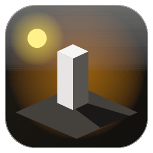 | **Real Shadows Lite** | `real-shadows-lite.hshader` | Мягкие динамические тени от солнца и луны с цветными тенями от витражей, оптимизированные под высокий FPS. |
|  | **Horizon Ultra** | `horizon-ultra.hshader` | Флагманский комбо-шейдер: мягкие тени, зеркальная вода, цветной 3D-свет, атмосферное небо, Bloom и Motion Blur. |
|  | **FPS Sharpness (CAS)** | `fps-sharpness.hshader` | Адаптивная чёткость AMD CAS — убирает «мыло» с текстур вдали без ореолов и практически с 0% нагрузки на видеокарту. |
|  | **Crystal Underwater** | `crystal-underwater.hshader` | Кристально чистая видимость под водой без мутного тумана + красивые солнечные каустики на морском дне. |
| 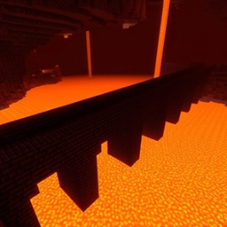 | **Clear Nether & End** | `clear-nether-end.hshader` | Полностью убирает густой туман в Незере и Энде и слегка подсвечивает тёмные своды для отличного обзора. |
|  | **Aurora & Starry Sky** | `aurora-starry-sky.hshader` | Переливающееся северное сияние и яркая россыпь звёзд с Млечным Путём на ночном небе. |
|  | **Golden Sunset** | `golden-sunset.hshader` | Тёплая кинематографическая атмосфера золотого часа, янтарное свечение солнца, мягкая виньетка и плёночный тон. |
|  | **Cinematic Bloom** | `cinematic-bloom.hshader` | Мягкое кинематографическое свечение ярких источников света — факелов, лавы, порталов, маяков и солнца. |
|  | **Anime Cel-Shading** | `anime-cel-shading.hshader` | Мультяшный стиль в духе аниме и Borderlands: чёткая контурная обводка граней по глубине и ступенчатый свет. |
|  | **Retro PS1 / CRT** | `retro-ps1-crt.hshader` | Атмосфера консолей 90-х: пикселизация, дизеринг палитры 15-bit и мягкие CRT-сканлайны кинескопа. |
|  | **Horror Fog** | `horror-fog.hshader` | Густой холодный туман как в Silent Hill, приглушённые мрачные тона, плёночное зерно и плотная виньетка. |
|  | **Cyberpunk Neon** | `cyberpunk-neon.hshader` | Неоновый киберпанк-стиль: бирюзово-пурпурное освещение, яркие светящиеся блоки и лёгкая хроматическая аберрация. |
|  | **No Fog** | `no-fog.hshader` | Полностью отключает любой туман в Обычном мире, Незере, Энде, под водой и в дождь для 100% видимости вдаль. |
|  | **True Darkness** | `true-darkness.hshader` | Хардкорная реалистичная темнота в пещерах и безлунной ночью — без факела в шахте действительно ничего не видно. |
| 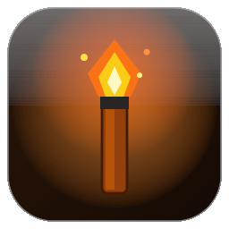 | **Warm Cozy Torchlight** | `warm-torchlight.hshader` | Уютный тёплый янтарный свет от факелов, костров и фонарей с мягким живым мерцанием пламени. |
|  | **Noir Black & White** | `noir-bw.hshader` | Контрастный чёрно-белый фильтр в стиле классического нуар-кино с опцией сохранения ярко-красных акцентов (Sin City). |
|  | **Pastel Dream** | `pastel-dream.hshader` | Мягкая сказочная пастельная цветовая гамма, осветлённые кремовые тени и нежное розово-лавандовое небо. |
|  | **Night Vision & Thermal** | `night-vision-thermal.hshader` | Тактический ПНВ и тепловизор (переключается одной галочкой в настройках шейдера: зелёный ПНВ или ИК-спектр). |
| 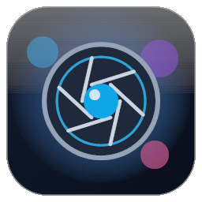 | **Depth of Field** | `depth-of-field.hshader` | Кинематографическое размытие фона (боке) с плавным автофокусом по центру прицела. |
|  | **Heat Haze** | `heat-haze.hshader` | Реалистичное марево раскалённого воздуха в пустынях, саваннах, бесплодных землях и в Незере. |
|  | **Blood Moon** | `blood-moon.hshader` | Багровое ночное небо, кроваво-красный ореол вокруг луны и зловещее алое освещение по ночам. |
|  | **PvP Boost Minimal** | `pvp-boost-minimal.hshader` | Киберспортивный PvP-шейдер: мягкий Fullbright, чёткость CAS, отключённый туман и сочный контраст с нулевой потерей FPS. |

## PvP и Combat ресурс-паки с Modrinth (300)

| Иконка | Название | Modrinth | Описание |
| :---: | :--- | :--- | :--- |
|  | **Low On Fire** | [low-on-fire](https://modrinth.com/resourcepack/low-on-fire) | Опускает пламя огня вниз экрана при горении в ванильном стиле — не закрывает обзор в PvP (18M+ скачиваний на Modrinth). |
|  | **Mandala's GUI - Dark mode** | [mandalas-gui-dark-mode](https://modrinth.com/resourcepack/mandalas-gui-dark-mode) | Элегантный тёмный интерфейс для инвентаря, сундуков, верстака и всех меню Minecraft без изменения блоков (7.5M+ скачиваний). |
|  | **Low Shield** | [low-shield-pack](https://modrinth.com/resourcepack/low-shield-pack) | Опускает щит ниже в руке, чтобы он не перекрывал противника и прицел во время боя (6M+ скачиваний). |
|  | **Enhanced Boss Bars** | [enhanced-boss-bars](https://modrinth.com/resourcepack/enhanced-boss-bars) | Стильные детализированные полоски здоровья боссов для Дракона Края, Визера и рейдов (5.5M+ скачиваний). |
|  | **Spunky PVP Texture Pack** | [spunky-pvp-texture-pack](https://modrinth.com/resourcepack/spunky-pvp-texture-pack) | Популярный PvP-пак от Spunky Insaan: короткие мечи, низкий огонь и чистые текстуры для дуэлей и SMP (2.2M+ скачиваний). |
|  | **Small Shield & Totem** | [small-shield-totem](https://modrinth.com/resourcepack/small-shield-totem) | Компактные щит и тотем бессмертия в руке + уменьшенная анимация срабатывания тотема (1.9M+ скачиваний). |
|  | **Dungeons Crit Sound** | [dungeons-crit-sound](https://modrinth.com/resourcepack/dungeons-crit-sound) | Заменяет стандартный звук критического удара на сочный и отчётливый звук из Minecraft Dungeons (1.8M+ скачиваний). |
|  | **CPVP Essentials ( Crystal PvP )** | [crystal-pvp-lt3-essentials](https://modrinth.com/resourcepack/crystal-pvp-lt3-essentials) | Профессиональный пак для Crystal PvP с максимальной видимостью взрывов, чистым огнём и чёткими звуками (1.6M+ скачиваний). |
|  | **Teddy Totems** | [teddy](https://modrinth.com/resourcepack/teddy) | Заменяет тотем бессмертия в левой руке на аккуратного плюшевого мишку, который не мешает обзору (1.5M+ скачиваний). |
|  | **PvP Crosshair** | [pvp-crosshair](https://modrinth.com/resourcepack/pvp-crosshair) | Чёткий минималистичный киберспортивный прицел для точной наводки в PvP (1.5M+ скачиваний). |
|  | **No Pumpkin Blur** | [no-pumpkin-blur](https://modrinth.com/resourcepack/no-pumpkin-blur) | Полностью убирает тёмную маску вырезанной тыквы с экрана для комфортных походов в Энд (1.3M+ скачиваний). |
|  | **defrosted** | [defrosted_pack](https://modrinth.com/resourcepack/defrosted_pack) | Чистый, лёгкий и стильный PvP-пак 16x в ледяной палитре с аккуратным оружием и блоками (1.3M+ скачиваний). |
| 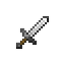 | **Mini Items** | [mini-items-pack](https://modrinth.com/resourcepack/mini-items-pack) | Уменьшает предметы в руке вдвое, освобождая максимум места на экране во время PvP (1M+ скачиваний). |
|  | **Aimz Better Crosshair** | [aimz-better-crosshair](https://modrinth.com/resourcepack/aimz-better-crosshair) | Современный контрастный прицел, улучшающий стандартный крестик по центру экрана (930K+ скачиваний). |
|  | **PvP Swords** | [short-pvp-swords](https://modrinth.com/resourcepack/short-pvp-swords) | Укороченные мечи всех тиров в чистом ванильном стиле для удобного обзора в бою (880K+ скачиваний). |
|  | **Fresh Weapons & Tools** | [fresh-weapons-and-tools](https://modrinth.com/resourcepack/fresh-weapons-and-tools) | Обновлённые детализированные ванильные мечи, топоры, кирки и инструменты с уникальным дизайном (720K+ скачиваний). |
|  | **small totem pop** | [small-totem-pop](https://modrinth.com/resourcepack/small-totem-pop) | Уменьшает всплывающую анимацию срабатывания тотема бессмертия, чтобы не перекрывать экран в бою (690K+ скачиваний). |
|  | **Transparent GUI and HUD** | [transparent-gui-and-hud](https://modrinth.com/resourcepack/transparent-gui-and-hud) | Прозрачные меню инвентаря, сундуков и HUD — сквозь открытый инвентарь всегда видно врагов (650K+ скачиваний). |
|  | **Mace Fusion** | [mace-fusion](https://modrinth.com/resourcepack/mace-fusion) | Проработанная 3D-модель булавы (Mace) с чистыми пропорциями в ванильном стиле (640K+ скачиваний). |
|  | **Reimagined GUI (Dark)** | [reimaginedguidark](https://modrinth.com/resourcepack/reimaginedguidark) | Современная тёмная переработка всех окон, кнопок и контейнеров Minecraft (630K+ скачиваний). |
|  | **No Enchant Glint** | [no-enchant-glint](https://modrinth.com/resourcepack/no-enchant-glint) | Убирает фиолетовый перелив зачарования с брони и оружия для чистого вида и плавного FPS (620K+ скачиваний). |
|  | **SenpaiSpider 1 Million Texture Pack** | [senpaispider-1-million-texture-pack](https://modrinth.com/resourcepack/senpaispider-1-million-texture-pack) | Знаменитый турнирный PvP-текстурпак от SenpaiSpider для дуэлей, Sword и SMP PvP (570K+ скачиваний). |
|  | **Animated Totem of Undying** | [animated-totem-of-undying](https://modrinth.com/resourcepack/animated-totem-of-undying) | Добавляет живую анимацию светящихся глаз у тотема бессмертия в руке (560K+ скачиваний). |
|  | **Amazing Mace 3d** | [amazing-mace-3d](https://modrinth.com/resourcepack/amazing-mace-3d) | Объёмная 3D-булава с выразительным силуэтом и детальной текстурой (530K+ скачиваний). |
|  | **Outlined Ores** | [ore-outlines](https://modrinth.com/resourcepack/ore-outlines) | Яркие контурные рамки вокруг всех руд в шахтах и пещерах — работает на чистой ваниле без модов (520K+ скачиваний). |
|  | **Vanilla Connected Glass** | [vanilla-connected-glass](https://modrinth.com/resourcepack/vanilla-connected-glass) | Чистое бесшовное стекло без лишних рамок, работающее без OptiFine и совместимое с другими паками (490K+ скачиваний). |
|  | **PVP SMP Deluxe** | [pvp-smp-deluxe](https://modrinth.com/resourcepack/pvp-smp-deluxe) | Сбалансированный ванильный PvP-пак для SMP: низкий огонь, низкий щит и аккуратное оружие (490K+ скачиваний). |
|  | **Crystal Vanilla Tweaks** | [crystal-vanilla-tweaks](https://modrinth.com/resourcepack/crystal-vanilla-tweaks) | Набор улучшений для Crystal PvP на базе ванилы: низкий огонь, меньше частиц и чистый обзор (485K+ скачиваний). |
|  | **Marlowww+** | [marlowww-plus](https://modrinth.com/resourcepack/marlowww-plus) | Легендарный минималистичный CPvP-пак Marlowww+ с фокусом на читаемость боя и высокий FPS (480K+ скачиваний). |
|  | **Simple Bedwars** | [simple-bedwars](https://modrinth.com/resourcepack/simple-bedwars) | Чистый и контрастный текстурпак для BedWars с аккуратной шерстью, блоками и оружием (190K+ скачиваний). |
|  | **Low Fire** | [low-fire-pack](https://modrinth.com/resourcepack/low-fire-pack) | Низкий огонь для чистого обзора в PvP (8.4M+ на Modrinth) — Lower your first-person fire to enhance visibility! |
|  | **Unique Dark** | [unique-dark](https://modrinth.com/resourcepack/unique-dark) | Тёмный/обновлённый интерфейс GUI и HUD (4.1M+ на Modrinth) — Dark GUI with unique textures for functional blocks. Dark mode for 80 mods |
|  | **Alacrity** | [alacrity](https://modrinth.com/resourcepack/alacrity) | Популярный PvP / Combat ресурс-пак с Modrinth (1.8M+ на Modrinth) — 32x resource pack with crazy attention to details |
|  | **AL's Dungeons Boss Bars** | [als-dungeons-boss-bars](https://modrinth.com/resourcepack/als-dungeons-boss-bars) | Стильные полоски здоровья боссов (1.7M+ на Modrinth) — A pack that makes the Boss Bars in the style of Minecraft Dungeons! |
|  | **Boss Refreshed** | [boss-refreshed](https://modrinth.com/resourcepack/boss-refreshed) | Популярный PvP / Combat ресурс-пак с Modrinth (1.7M+ на Modrinth) — Minecraft's Bosses with a Refreshed Take! |
|  | **Enchantment Glows** | [enchantment-glows](https://modrinth.com/resourcepack/enchantment-glows) | Улучшенные эффекты и книги зачарований (1.5M+ на Modrinth) — Adds a glowing visual effect to enchanted tools |
|  | **Excalibur** | [excal](https://modrinth.com/resourcepack/excal) | Популярный PvP / Combat ресурс-пак с Modrinth (933K+ на Modrinth) — Epic Medieval Fantasy |
|  | **Dark Smooth GUI** | [dark-smooth-gui](https://modrinth.com/resourcepack/dark-smooth-gui) | Тёмный/обновлённый интерфейс GUI и HUD (917K+ на Modrinth) — Adds a dark smooth GUI to Minecraft, with support for many mods GUIs |
|  | **Armory Conglomery** | [armory-conglomery](https://modrinth.com/resourcepack/armory-conglomery) | Обновлённая броня и снаряжение (768K+ на Modrinth) — Armors with a Refreshed Take! |
|  | **Visual Enchantments** | [visual-enchantments](https://modrinth.com/resourcepack/visual-enchantments) | Улучшенные эффекты и книги зачарований (692K+ на Modrinth) — A resourcepack that adds visual indicators to enchanted items |
|  | **STONEBORN UI Overhaul** | [stoneborn](https://modrinth.com/resourcepack/stoneborn) | Тёмный/обновлённый интерфейс GUI и HUD (641K+ на Modrinth) — STONEBORN is a simple and unique UI overhaul inspired by fantasy media. |
|  | **Low Fire 🔥** | [lower-fire](https://modrinth.com/resourcepack/lower-fire) | Низкий огонь для чистого обзора в PvP (606K+ на Modrinth) — reduces or lowers the Minecraft fire texture, to make it less obstructive. Includes new... |
| 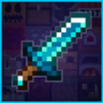 | **Faithless** | [faithless](https://modrinth.com/resourcepack/faithless) | Тёмный/обновлённый интерфейс GUI и HUD (550K+ на Modrinth) — Faithful to vanilla, yet a complete overhaul! - Building, Redstone, Survival, PvP... All in... |
| 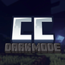 | **Colourful containers Dark Mode GUI** | [colourful-containers-dark-mode-gui](https://modrinth.com/resourcepack/colourful-containers-dark-mode-gui) | Тёмный/обновлённый интерфейс GUI и HUD (527K+ на Modrinth) — A container GUI replacement mod that hopes to match the menu to every one of Minecraft's... |
| 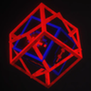 | **PvP Scroutopia** | [pvp](https://modrinth.com/resourcepack/pvp) | Crystal PvP пак (484K+ на Modrinth) — A Crystal PvP, Sword PvP and Axe PvP texture pack, which includes low fire, small items and... |
|  | **GUI Revision Dark** | [gui-revision-dark](https://modrinth.com/resourcepack/gui-revision-dark) | Тёмный/обновлённый интерфейс GUI и HUD (462K+ на Modrinth) — Revamps the vanilla GUI with a darker and cleaner look! (Mod support) |
|  | **Blades of Majestica** | [blades-of-majestica](https://modrinth.com/resourcepack/blades-of-majestica) | PvP-пак с укороченными/обновлёнными мечами (448K+ на Modrinth) — Pack that allows you to change boring minecraft swords into majestic fantasy weapons! |
|  | **Potato Graphics** | [potato-graphics](https://modrinth.com/resourcepack/potato-graphics) | Лёгкий PvP-текстурпак с упором на FPS (444K+ на Modrinth) — Give your game a hilarious low-end makeover! This pack turns every block into a single... |
|  | **Better Scaffolding Visibility** | [better-scaffolding-visibility](https://modrinth.com/resourcepack/better-scaffolding-visibility) | Улучшенная видимость паутины/блоков в бою (436K+ на Modrinth) — Better Scaffolding removes the middle texture for better visibility. A simple resource pack... |
| 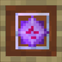 | **No Explosion Particles** | [no-explosion-particles](https://modrinth.com/resourcepack/no-explosion-particles) | Crystal PvP пак (424K+ на Modrinth) — This texture pack removes particles created by explosions. Immediately makes you better at... |
| 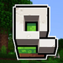 | **Quadral** | [quadral](https://modrinth.com/resourcepack/quadral) | Популярный PvP / Combat ресурс-пак с Modrinth (424K+ на Modrinth) — A bright, crisp design with vibrant colours. When you need a refreshing change from... |
|  | **Low Shield PvP** | [low-shield-pvp](https://modrinth.com/resourcepack/low-shield-pvp) | Компактный/опущенный щит для PvP (411K+ на Modrinth) — This texture pack makes your shield lower so that you can PvP better. |
|  | **PvP Essentials** | [pvp-essentials](https://modrinth.com/resourcepack/pvp-essentials) | Низкий огонь для чистого обзора в PvP (397K+ на Modrinth) — Every Essential YOU Need For PvP! Includes No Bobber, No Fire, Low Shield, Small Totem Pop,... |
|  | **Spryzeen's Knight Armor** | [spryzeens-knight-armor](https://modrinth.com/resourcepack/spryzeens-knight-armor) | Обновлённая броня и снаряжение (375K+ на Modrinth) — Better armors, knight armors! |
|  | **Recolourful Containers GUI + HUD (DARK)** | [recolourful-containers-gui-hud-dark](https://modrinth.com/resourcepack/recolourful-containers-gui-hud-dark) | Тёмный/обновлённый интерфейс GUI и HUD (364K+ на Modrinth) — Do you want more immersive and more colourful GUIs and HUD? Than this pack is for you! NOW... |
| 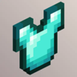 | **(Bee's) Fine Armory** | [fine-armoury](https://modrinth.com/resourcepack/fine-armoury) | Обновлённая броня и снаряжение (333K+ на Modrinth) — My retextures of tools, weapons, and armour sets |
| 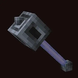 | **Mace 3D** | [mase-3d-by-nestter](https://modrinth.com/resourcepack/mase-3d-by-nestter) | 3D / PvP пак для булавы (Mace) (327K+ на Modrinth) — 3d model for the mace |
| 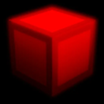 | **Wool Simple** | [simple-wool](https://modrinth.com/resourcepack/simple-wool) | PvP / BedWars пак (310K+ на Modrinth) — Simpler and better looking wool for bedwars and Minecraft. |
| 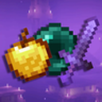 | **SMP Basics** | [smp-basics](https://modrinth.com/resourcepack/smp-basics) | Сбалансированный PvP-пак для SMP и дуэлей (305K+ на Modrinth) — The basics for SMP PvP! jump into your next pvp battle with SMP Basics for Survival... |
|  | **Crosshair TXF** | [crosshair-txf](https://modrinth.com/resourcepack/crosshair-txf) | Контрастный PvP-прицел (297K+ на Modrinth) — New design for minecraft crosshair |
|  | **Smaller Totem** | [small-totem](https://modrinth.com/resourcepack/small-totem) | Компактный/улучшенный тотем бессмертия (294K+ на Modrinth) — Makes the totem smaller. |
|  | **FerreMcDurabilityOverlay** | [ferremcdurabilityoverlay](https://modrinth.com/resourcepack/ferremcdurabilityoverlay) | Обновлённая броня и снаряжение (280K+ на Modrinth) — This Pack shows the durability of armour. |
| 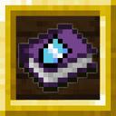 | **Mars's Enchanted Book Textures** | [different-textures-for-enchanted-books](https://modrinth.com/resourcepack/different-textures-for-enchanted-books) | Улучшенные эффекты и книги зачарований (279K+ на Modrinth) — Changes textures of enchanted books for better clarity |
|  | **Visible Shield Cooldown** | [visible-shield-cooldown-rp](https://modrinth.com/resourcepack/visible-shield-cooldown-rp) | Компактный/опущенный щит для PvP (277K+ на Modrinth) — Shows you the status of your shield on cooldown (when it is disabled). Like the shield... |
|  | **Fire remover (no fire)** | [no-fire](https://modrinth.com/resourcepack/no-fire) | Низкий огонь для чистого обзора в PvP (272K+ на Modrinth) — remove annoying fire |
|  | **SideShieldTexturePack** | [sideshieldpack](https://modrinth.com/resourcepack/sideshieldpack) | Компактный/опущенный щит для PvP (269K+ на Modrinth) — Side Shield And Small Blocking Texture Pack. |
|  | **Torturable Healthbars** | [torturable-healthbars](https://modrinth.com/resourcepack/torturable-healthbars) | Популярный PvP / Combat ресурс-пак с Modrinth (265K+ на Modrinth) — Instead of a health bar above the entity, health is shown as visual injuries on the mob |
|  | **3D Mace!** | [3d-mace](https://modrinth.com/resourcepack/3d-mace) | 3D / PvP пак для булавы (Mace) (257K+ на Modrinth) — Simple 3D mace I made in my spare time. |
| 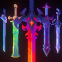 | **Fantasy 3D Weapons CIT** | [fantasy-3d-weapons-cit](https://modrinth.com/resourcepack/fantasy-3d-weapons-cit) | Популярный PvP / Combat ресурс-пак с Modrinth (253K+ на Modrinth) — Adds 3D weapon models to MC! (Custom Item Textures) |
|  | **Detail Brush** | [detail-brush](https://modrinth.com/resourcepack/detail-brush) | Популярный PvP / Combat ресурс-пак с Modrinth (252K+ на Modrinth) — Polishes and redesigns a few items in Minecraft! |
|  | **KingD3fault's [Fan Made]** | [kingd3faults](https://modrinth.com/resourcepack/kingd3faults) | Crystal PvP пак (250K+ на Modrinth) — A pack for KingD3fault (NOT OFFICIAL) for crystal pvp or cpvp |
| 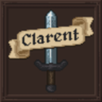 | **Excalibur | Clarent Edition** | [clarent](https://modrinth.com/resourcepack/clarent) | Популярный PvP / Combat ресурс-пак с Modrinth (246K+ на Modrinth) — Clarent preserves the Excalibur experience by backporting features, fixing bugs, and... |
| 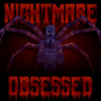 | **Nightmare Obsessed** | [nightmare-obsessed](https://modrinth.com/resourcepack/nightmare-obsessed) | Популярный PvP / Combat ресурс-пак с Modrinth (240K+ на Modrinth) — Reskins The Obsessed into a consistently creepy design, including adjusted animations and forms |
|  | **PvP Basics** | [pvp-basics](https://modrinth.com/resourcepack/pvp-basics) | Низкий огонь для чистого обзора в PvP (236K+ на Modrinth) — Purely vanilla, all-in-one PvP pack. Features: small fire and pop, and more! |
| 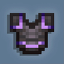 | **PvP Utils** | [pvp-utils](https://modrinth.com/resourcepack/pvp-utils) | Популярный PvP / Combat ресурс-пак с Modrinth (235K+ на Modrinth) — A texture pack, which adds Quality of Life Improvements for PvP, while keeping it in a... |
|  | **Crosshair v3** | [crosshair-v3](https://modrinth.com/resourcepack/crosshair-v3) | Контрастный PvP-прицел (225K+ на Modrinth) — Simple crosshair to enhance the PvP experience. |
|  | **Lower Shield** | [lower-shield](https://modrinth.com/resourcepack/lower-shield) | Компактный/опущенный щит для PvP (223K+ на Modrinth) — Decreases the amount of space the shield takes up on screen. |
|  | **Swight Texure Pack** | [axe-pvp-texure-pack](https://modrinth.com/resourcepack/axe-pvp-texure-pack) | PvP-пак с укороченными/обновлёнными мечами (221K+ на Modrinth) — A texure Pack for pvp, Reocommand for UHC, sword and Axe pvp! |
| 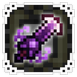 | **Stellarity Resource Pack** | [stellarity-rp](https://modrinth.com/resourcepack/stellarity-rp) | Популярный PvP / Combat ресурс-пак с Modrinth (218K+ на Modrinth) — Resource pack for Stellarity. Contains textures for all of its items, plus some other... |
| 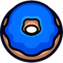 | **Donut Smp Essentials** | [donut-smp-essentials](https://modrinth.com/resourcepack/donut-smp-essentials) | Сбалансированный PvP-пак для SMP и дуэлей (218K+ на Modrinth) — This texture pack has Donut Smp essentials which will help you raise your place on the... |
|  | **GUI Retextures** | [gui-retextures](https://modrinth.com/resourcepack/gui-retextures) | Тёмный/обновлённый интерфейс GUI и HUD (218K+ на Modrinth) — Makes GUI and HUD fancier - Dark mode, configurability with Respackopts |
|  | **ItzRealMe Edit** | [itzrealme-edit](https://modrinth.com/resourcepack/itzrealme-edit) | Популярный PvP / Combat ресурс-пак с Modrinth (214K+ на Modrinth) — An UNOFFICIAL ItzRealMe Texturepack |
|  | **PvP Haimiya Pack + Anime sky** | [pvp-haimiya-anime-pack](https://modrinth.com/resourcepack/pvp-haimiya-anime-pack) | Crystal PvP пак (211K+ на Modrinth) — The PvP/CPvP resource pack "Haimiya" adds a variety of textures, from the sky overlay to... |
|  | **Ore Visible** | [ore.](https://modrinth.com/resourcepack/ore.) | Тёмный/обновлённый интерфейс GUI и HUD (205K+ на Modrinth) — A resource pack that makes spotting ores in dark caves much easier. |
|  | **Short Swords** | [short-swords-pack](https://modrinth.com/resourcepack/short-swords-pack) | PvP-пак с укороченными/обновлёнными мечами (199K+ на Modrinth) — Experience a clearer view and smoother swings! |
|  | **Armors'N'Items - By StefanJ2** | [stefansarmorsnitems](https://modrinth.com/resourcepack/stefansarmorsnitems) | Тёмный/обновлённый интерфейс GUI и HUD (195K+ на Modrinth) — Adds a huge collection of custom items through anvil renaming, without any required mods. |
| 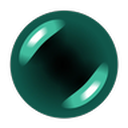 | **SMP PvP Essentials** | [smp-pvp-essentials](https://modrinth.com/resourcepack/smp-pvp-essentials) | Сбалансированный PvP-пак для SMP и дуэлей (191K+ на Modrinth) — This texture pack, SMP PvP Essentials, will help you climb the ranks in SMP! |
| 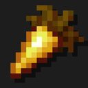 | **Eating Animation** | [eating-animation-resourcepack](https://modrinth.com/resourcepack/eating-animation-resourcepack) | Популярный PvP / Combat ресурс-пак с Modrinth (182K+ на Modrinth) — Adds animation for eating food and drinking potions |
|  | **Cobweb Outline** | [cobweb-outline](https://modrinth.com/resourcepack/cobweb-outline) | Улучшенная видимость паутины/блоков в бою (173K+ на Modrinth) — Highlights cobwebs with a clean outline to improve visibility and control during PvP fights |
|  | **ArshuSmpOverlay(Spear&Mace)** | [pvp-texture-pack](https://modrinth.com/resourcepack/pvp-texture-pack) | 3D / PvP пак для булавы (Mace) (172K+ на Modrinth) — Best Smp & Pvps Overlay Pack. |
|  | **ItzRealMes Overlay** | [itzrealmes-overlay](https://modrinth.com/resourcepack/itzrealmes-overlay) | Crystal PvP пак (170K+ на Modrinth) — Crystal PvP Overlay to look like ItzRealMes. |
|  | **Simple PvP Edit** | [simple-pvp-edit](https://modrinth.com/resourcepack/simple-pvp-edit) | Популярный PvP / Combat ресурс-пак с Modrinth (169K+ на Modrinth) — This Minecraft Resource Pack enhances the aesthetics of PvP |
| 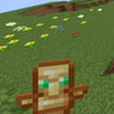 | **Smaller Totem** | [small-low-totem](https://modrinth.com/resourcepack/small-low-totem) | Компактный/улучшенный тотем бессмертия (169K+ на Modrinth) — Makes Totem smaller in size and low for better PvP. |
|  | **Marlowww Vanila PVP+** | [kreklinokpackpvp](https://modrinth.com/resourcepack/kreklinokpackpvp) | PvP-пак с укороченными/обновлёнными мечами (167K+ на Modrinth) — 1.4.2–26.3 | A clean PvP resource pack with short swords, smaller fire and improved item... |
|  | **Tightfault Revamp Edit** | [tightfault-revamp-edit](https://modrinth.com/resourcepack/tightfault-revamp-edit) | Популярный PvP / Combat ресурс-пак с Modrinth (166K+ на Modrinth) — A small edit for the pack "Tightfault" for later versions of the game |
|  | **Small Items+** | [small.](https://modrinth.com/resourcepack/small.) | Низкий огонь для чистого обзора в PvP (165K+ на Modrinth) — low fire, small items, small totem, small totem pop, small shield, clear water,... |
|  | **PvP for Cuties** | [pvp-for-cuties](https://modrinth.com/resourcepack/pvp-for-cuties) | Популярный PvP / Combat ресурс-пак с Modrinth (163K+ на Modrinth) — A PvP Texturepack for Cuties by Cuties :3 |
|  | **Diamond SMP PVP default TexturePack** | [diamond-smp-pvp-default-texturepack](https://modrinth.com/resourcepack/diamond-smp-pvp-default-texturepack) | Сбалансированный PvP-пак для SMP и дуэлей (161K+ на Modrinth) — This is a texture pack for pvp. i have never really seen any default packs with all the... |
|  | **DrDonut's Fan Pack** | [drdonuts](https://modrinth.com/resourcepack/drdonuts) | Популярный PvP / Combat ресурс-пак с Modrinth (161K+ на Modrinth) — An UNOFFICIAL fan-made texturepack for DrDonut |
|  | **Smaller side shield** | [smaller-side-shield](https://modrinth.com/resourcepack/smaller-side-shield) | Компактный/опущенный щит для PvP (160K+ на Modrinth) — Side shield but smaller when blocking |
|  | **GUI** | [gui.](https://modrinth.com/resourcepack/gui.) | Тёмный/обновлённый интерфейс GUI и HUD (158K+ на Modrinth) — Fully black GUI for modern versions of Minecraft. |
|  | **PvP Overlay** | [cattos-overlay](https://modrinth.com/resourcepack/cattos-overlay) | PvP-оверлей (совместим поверх других паков) (156K+ на Modrinth) — Overlay mainly focused on QoL features to help with Minecraft Combat |
| 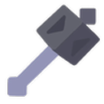 | **MacePvP Essentials** | [macepvp-essentials](https://modrinth.com/resourcepack/macepvp-essentials) | 3D / PvP пак для булавы (Mace) (155K+ на Modrinth) — This texture pack, Mace PvP Essentials, will help you climb the ranks in MacePvP! |
| 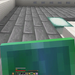 | **Small Shield** | [small-shield](https://modrinth.com/resourcepack/small-shield) | Компактный/опущенный щит для PvP (153K+ на Modrinth) — Smaller Shield, like the one Marlowww, ItzRealMe, Camcal, Thebes, Awerial, Evantii and... |
| 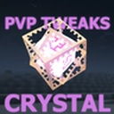 | **Crystal PvP Tweaks** | [crystal-pvp-tweaks](https://modrinth.com/resourcepack/crystal-pvp-tweaks) | Crystal PvP пак (148K+ на Modrinth) — Optimized. Clear. Precise. |
|  | **BlockPixel** | [blockpixel](https://modrinth.com/resourcepack/blockpixel) | Лёгкий PvP-текстурпак с упором на FPS (145K+ на Modrinth) — This is a Minecraft pixel texture pack created by Jakob.zero, characterized by using... |
|  | **Low Fire EXTREME** | [low-fire-extreme](https://modrinth.com/resourcepack/low-fire-extreme) | Низкий огонь для чистого обзора в PvP (143K+ на Modrinth) — This Resourcepack aims to make the fire overlay even lower then other packs |
| 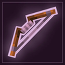 | **Glowing 3D Items** | [glowing-glints-3d](https://modrinth.com/resourcepack/glowing-glints-3d) | Улучшенные эффекты и книги зачарований (140K+ на Modrinth) — Adds unique 3D models to many items in the game. |
|  | **Daggers** | [daggers](https://modrinth.com/resourcepack/daggers) | PvP-пак с укороченными/обновлёнными мечами (137K+ на Modrinth) — Shorter swords for better visibility. |
| 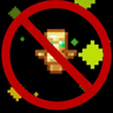 | **No Totem Pop Animation Texture Pack** | [nototemanimaton](https://modrinth.com/resourcepack/nototemanimaton) | Компактный/улучшенный тотем бессмертия (134K+ на Modrinth) — The Totem Pop Animation is removed with this pack. |
| 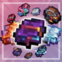 | **Enchantment Enhancements** | [vipers-enchantment-enhancements](https://modrinth.com/resourcepack/vipers-enchantment-enhancements) | Улучшенные эффекты и книги зачарований (132K+ на Modrinth) — Gives enchanted books a new unique look! |
|  | **Zipp CPVP Pack** | [zipp-cpvp](https://modrinth.com/resourcepack/zipp-cpvp) | Crystal PvP пак (131K+ на Modrinth) — Zipp CPVP Pack brings a clean and clear PvP experience. It features short swords, a black... |
|  | **CPvP Marin Kitagawa PvP Pack + Anime sky** | [marin-kitagawa-pack-plus-anime-sky](https://modrinth.com/resourcepack/marin-kitagawa-pack-plus-anime-sky) | Crystal PvP пак (130K+ на Modrinth) — This PvP/CPvP resource pack replaces the model textures, sounds, GUI, inventory, menu, and... |
|  | **Small Totem** | [better-small-totem](https://modrinth.com/resourcepack/better-small-totem) | Компактный/улучшенный тотем бессмертия (130K+ на Modrinth) — Makes your totem and pop smaller |
| 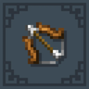 | **Stylus's Bow Retexture** | [stylus-bow-retexture](https://modrinth.com/resourcepack/stylus-bow-retexture) | Улучшенные текстуры лука, арбалета и стрел (129K+ на Modrinth) — A retexture of the bow, crossbow and arrows + new 2D models for the arrows! |
|  | **PvP Fundamentals** | [pvp-fundamentals](https://modrinth.com/resourcepack/pvp-fundamentals) | Популярный PvP / Combat ресурс-пак с Modrinth (74K+ на Modrinth) — A Texturepack That Contains Everything Needed for PvP |
|  | **Crazy PvP Pack** | [crazy-pvp-pack](https://modrinth.com/resourcepack/crazy-pvp-pack) | Популярный PvP / Combat ресурс-пак с Modrinth (74K+ на Modrinth) — A PvP focused resource pack with stunning textures, smooth performance, and combat... |
| 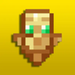 | **Mini Totem** | [mini-totem](https://modrinth.com/resourcepack/mini-totem) | Crystal PvP пак (74K+ на Modrinth) — Makes the totem of undying small or mini! Great for crystal pvp or regular survival! |
|  | **Living Legend Rewamped** | [living-legend-80k-rewamped](https://modrinth.com/resourcepack/living-legend-80k-rewamped) | Тёмный/обновлённый интерфейс GUI и HUD (73K+ на Modrinth) — A clean and optimized PvP/SMP resource pack with low particles, smooth GUI, and enhanced... |
|  | **No Totem Pop Particles for Crystal PvP** | [no-totem-pop-particles-for-crystal-pvp](https://modrinth.com/resourcepack/no-totem-pop-particles-for-crystal-pvp) | Crystal PvP пак (71K+ на Modrinth) — This resource pack removes all particles when your totem inevitable pops. |
|  | **Aimz Lunar Arrow Crosshair** | [aimz-lunar-arrow-crosshair](https://modrinth.com/resourcepack/aimz-lunar-arrow-crosshair) | Контрастный PvP-прицел (71K+ на Modrinth) — A PVP focused crosshair that changes the vanilla crosshair into a pvp one |
| 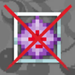 | **No Explosion Particles** | [better-no-explosion-particles](https://modrinth.com/resourcepack/better-no-explosion-particles) | Crystal PvP пак (70K+ на Modrinth) — This Pack removes explosion particles and makes you better at crystal PVP |
|  | **PvP Sora** | [pvp-sora](https://modrinth.com/resourcepack/pvp-sora) | Популярный PvP / Combat ресурс-пак с Modrinth (70K+ на Modrinth) — A PVP Resource Pack that WILL improve your skill level! |
| 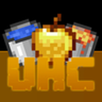 | **UHC Basics** | [uhc-basics](https://modrinth.com/resourcepack/uhc-basics) | Подсветка и улучшенная видимость руд (69K+ на Modrinth) — A UHC (ultra hardcore) texturepack that is tailored towards Minecraft UHC players! Great... |
| 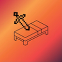 | **Death of the Beds for Bedwars** | [death-of-the-beds](https://modrinth.com/resourcepack/death-of-the-beds) | PvP / BedWars пак (69K+ на Modrinth) — a bedwars texture pack, for simple and easy pvp |
|  | **ItzRealMe Vanilla Overlay** | [itzrealme-vanilla](https://modrinth.com/resourcepack/itzrealme-vanilla) | PvP-оверлей (совместим поверх других паков) (68K+ на Modrinth) — ItzRealMe's Official Overlay for people to use. It features many quality of life aspects in... |
| 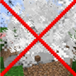 | **No Explosions Particles** | [no-explosions-particles](https://modrinth.com/resourcepack/no-explosions-particles) | Crystal PvP пак (67K+ на Modrinth) — Useful for crystal pvp, it can reduce lag. |
|  | **Masuno PvP Pack** | [masuno-mace](https://modrinth.com/resourcepack/masuno-mace) | 3D / PvP пак для булавы (Mace) (67K+ на Modrinth) — A resource pack aimed to enhance Minecraft Mace PvP! (Low Fire & Lower Shield Included, as... |
| 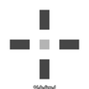 | **PVP CROSSHAIR** | [pvp-crosshair.](https://modrinth.com/resourcepack/pvp-crosshair.) | Контрастный PvP-прицел (64K+ на Modrinth) — CUSTOM CROSSHAIR FOR PVP MINECRAFT |
|  | **Better Shield Sounds** | [better-shield-sounds](https://modrinth.com/resourcepack/better-shield-sounds) | Компактный/опущенный щит для PvP (61K+ на Modrinth) — Better Shield Stun Sounds For PvP! |
|  | **(Unofficial) Mandala's GUI - Dark Mode Mod Compatibility** | [unofficial-mandalas-gui-dark-mode-mod-compatibility](https://modrinth.com/resourcepack/unofficial-mandalas-gui-dark-mode-mod-compatibility) | Тёмный/обновлённый интерфейс GUI и HUD (1.5M+ на Modrinth) — Unofficial Custom Mandala's GUI - Dark Mode Mod Compatibility |
|  | **Mandala's GUI Vanilla Crosshair** | [mandalas-gui-vanilla-crosshair](https://modrinth.com/resourcepack/mandalas-gui-vanilla-crosshair) | Контрастный PvP-прицел (1.2M+ на Modrinth) — A patch for Mandala's GUI to use the vanilla crosshair. |
|  | **Shiny Hearts** | [shiny-hearts](https://modrinth.com/resourcepack/shiny-hearts) | Чистый/обновлённый PvP-хотбар (775K+ на Modrinth) — New great look of hearts and other icons in hotbar! |
|  | **Player Health Indicators** | [health](https://modrinth.com/resourcepack/health) | Популярный PvP / Combat ресурс-пак с Modrinth (516K+ на Modrinth) — Shows hearts/health above player heads as healthbars |
| 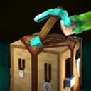 | **Actually 3D Blocks & Items!** | [actually-3d-blocks-and-items](https://modrinth.com/resourcepack/actually-3d-blocks-and-items) | PvP / 3D пак для булавы (Mace) (291K+ на Modrinth) — 3D resourcepack, which makes a lot of Blocks and Items more detailed, smoother and Actually... |
|  | **Essential UI** | [essentialui](https://modrinth.com/resourcepack/essentialui) | Чистый/обновлённый PvP-хотбар (278K+ на Modrinth) — A small texturepack, that changes all buttons and the hotbar to fit the style of the... |
| 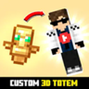 | **Custom Totem 3D** | [custom-totem-3d](https://modrinth.com/resourcepack/custom-totem-3d) | Компактный/кастомный тотем бессмертия (258K+ на Modrinth) — Customizable 3D Totem resource pack that lets you use your own skin as the Totem of Undying |
|  | **Simple Hotbar** | [simple-hotbar](https://modrinth.com/resourcepack/simple-hotbar) | Чистый/обновлённый PvP-хотбар (226K+ на Modrinth) — Resource Pack that changes hotbar, hearts and armor icons |
| 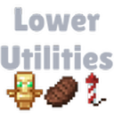 | **Low Fire, Shield & More** | [lower-utilites](https://modrinth.com/resourcepack/lower-utilites) | Низкий/чистый огонь для PvP (223K+ на Modrinth) — Makes shield, food, totems, rockets, potions and fire lower and also adds eating animation |
|  | **Totem Da Capoeira** | [totem-da-capoeira](https://modrinth.com/resourcepack/totem-da-capoeira) | Компактный/кастомный тотем бессмертия (208K+ на Modrinth) — Finally gives Totem of Undying a good texture |
|  | **Low Fire One Pixel** | [low-fire-one-pixel](https://modrinth.com/resourcepack/low-fire-one-pixel) | Низкий/чистый огонь для PvP (192K+ на Modrinth) — The low fire that's only one pixel tall |
|  | **Spryzeen's Healthbars** | [spryzeens-healthbars](https://modrinth.com/resourcepack/spryzeens-healthbars) | Популярный PvP / Combat ресурс-пак с Modrinth (188K+ на Modrinth) — Check the health of any mob... |
|  | **Bare Bones - Low On Fire** | [bare-bones-low-on-fire](https://modrinth.com/resourcepack/bare-bones-low-on-fire) | Низкий/чистый огонь для PvP (186K+ на Modrinth) — Reduces the fire height when burning! |
|  | **Light Levels** | [light-levels](https://modrinth.com/resourcepack/light-levels) | Популярный PvP / Combat ресурс-пак с Modrinth (178K+ на Modrinth) — Visualize significant light levels |
|  | **Low Fire TXF** | [low-fire-txf](https://modrinth.com/resourcepack/low-fire-txf) | Низкий/чистый огонь для PvP (170K+ на Modrinth) — Less intrusive fire |
|  | **Combat Amenities 2D Tridents** | [combat-amenities-2d-tridents](https://modrinth.com/resourcepack/combat-amenities-2d-tridents) | Популярный PvP / Combat ресурс-пак с Modrinth (144K+ на Modrinth) — A textures packs that utilizes features from Combat Amenities to make tridents use a 2D model |
| 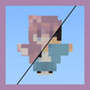 | **Customizable Totem** | [totem](https://modrinth.com/resourcepack/totem) | Компактный/кастомный тотем бессмертия (138K+ на Modrinth) — By adding your own skin to the pack, the totem of undying will update to look like... |
| 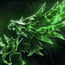 | **ZickZack V5** | [zickzack-v5](https://modrinth.com/resourcepack/zickzack-v5) | Компактный/кастомный тотем бессмертия (134K+ на Modrinth) — A texture pack in the style of BastiGHG and ZickZackV5, which contains a custom sky,... |
|  | **Fresh AI Tweaks** | [fresh-ai-tweaks](https://modrinth.com/resourcepack/fresh-ai-tweaks) | Популярный PvP / Combat ресурс-пак с Modrinth (130K+ на Modrinth) — Allows Fresh Animations to work with Mob AI Tweaks |
|  | **MYTHIC - A Pixel Art Journey** | [mythic-a-pixel-art-journey](https://modrinth.com/resourcepack/mythic-a-pixel-art-journey) | Популярный PvP / Combat ресурс-пак с Modrinth (126K+ на Modrinth) — A 32x pure pixel art pack with an adventurous feel. |
|  | **Altar SMP Texture Pack** | [altar-smp-texture-pack](https://modrinth.com/resourcepack/altar-smp-texture-pack) | PvP-пак для SMP и дуэлей (125K+ на Modrinth) — Adds the Legendary weapons from Altar SMP |
|  | **CrossAttack** | [crossattack](https://modrinth.com/resourcepack/crossattack) | Контрастный PvP-прицел (124K+ на Modrinth) — You dont find the crosshairs odd? This resource pack fixes this problem by making crosshair... |
|  | **Bare Bones X PvP Pack** | [bare-bones-x-pvp-pack](https://modrinth.com/resourcepack/bare-bones-x-pvp-pack) | Популярный PvP / Combat ресурс-пак с Modrinth (124K+ на Modrinth) — A Simple PvP Pack for BARE BONES User |
|  | **Totem & Stuff** | [totem-stuff](https://modrinth.com/resourcepack/totem-stuff) | Компактный/кастомный тотем бессмертия (122K+ на Modrinth) — Action & Stuff Inspired Transparent Totem Model. |
| 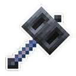 | **3D Mace** | [3d-mace-rp](https://modrinth.com/resourcepack/3d-mace-rp) | PvP / 3D пак для булавы (Mace) (121K+ на Modrinth) — A resource pack that changes the mace to 3D without losing vanilla. |
| 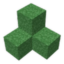 | **Fast Grass + FPS Boost** | [fast-grass-plusfps-boost](https://modrinth.com/resourcepack/fast-grass-plusfps-boost) | Яркая подсветка руд в шахтах (119K+ на Modrinth) — Smooth, clean grass blocks for calmer and more consistent terrain. |
| 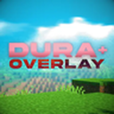 | **Showy's Durability+ Overlay** | [showy-durability-plus-overlay](https://modrinth.com/resourcepack/showy-durability-plus-overlay) | Тёмный/обновлённый интерфейс GUI и HUD (119K+ на Modrinth) — A resourcepack which adds custom durability based textures to be able to see how much... |
|  | **Duskfall-UI** | [duskfall-ui](https://modrinth.com/resourcepack/duskfall-ui) | Тёмный/обновлённый интерфейс GUI и HUD (119K+ на Modrinth) — A dark GUI theme. |
| 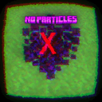 | **No Particles Essential** | [no-particles-essential](https://modrinth.com/resourcepack/no-particles-essential) | Уменьшенные частицы для высокого FPS и обзора (118K+ на Modrinth) — A ResouecePack that prevents any type of particle from being rendered |
| 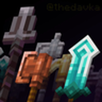 | **Fabulous 3D** | [davkas-fabulous-3d-swords](https://modrinth.com/resourcepack/davkas-fabulous-3d-swords) | PvP-пак с укороченными/обновлёнными мечами (118K+ на Modrinth) — Clean redesigns of the vanilla Tools and Weapons. |
| 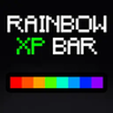 | **Rainbow XP Bar** | [rainbow-xp-bar](https://modrinth.com/resourcepack/rainbow-xp-bar) | Яркая подсветка руд в шахтах (117K+ на Modrinth) — Rainbow XP Progress Bar is a vibrant texture pack designed to make your Minecraft XP bar... |
| 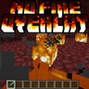 | **No Fire Overlay** | [no-fire-overlay](https://modrinth.com/resourcepack/no-fire-overlay) | Низкий/чистый огонь для PvP (116K+ на Modrinth) — Removes the annoying fire overlay that takes up your screen |
|  | **Crosshair Enahnced** | [crosshair-enahnced](https://modrinth.com/resourcepack/crosshair-enahnced) | Контрастный PvP-прицел (116K+ на Modrinth) — A Minecraft crosshair enhancement texturepack! |
| 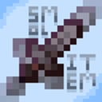 | **Truly Small Items** | [small-items](https://modrinth.com/resourcepack/small-items) | Яркая подсветка руд в шахтах (116K+ на Modrinth) — A real resource pack for small items. Textures are painstakingly modified to fit the... |
|  | **3D totem** | [3d-totem](https://modrinth.com/resourcepack/3d-totem) | Компактный/кастомный тотем бессмертия (116K+ на Modrinth) — This resourcepack will replace the standard 2d totem of undying an improved 3d version. |
|  | **Bluxy-Crystal (Crystal PvP)** | [bluxycrystal](https://modrinth.com/resourcepack/bluxycrystal) | Crystal PvP пак (115K+ на Modrinth) — Crystal PvP pack with a modern, smooth, sleek style for immersive gameplay. |
|  | **Animated Hotbar RGB** | [animated-hotbar-rgb](https://modrinth.com/resourcepack/animated-hotbar-rgb) | Чистый/обновлённый PvP-хотбар (114K+ на Modrinth) — Enhance your Minecraft experience with sleek, color-cycling neon borders for your hotbar slots. |
|  | **Fallen || PvP Texturepack** | [fallen-pvp](https://modrinth.com/resourcepack/fallen-pvp) | Популярный PvP / Combat ресурс-пак с Modrinth (113K+ на Modrinth) — A Purple Themed PvP Texturepack |
|  | **Refined Tools** | [refined-tools](https://modrinth.com/resourcepack/refined-tools) | Популярный PvP / Combat ресурс-пак с Modrinth (112K+ на Modrinth) — This resourcepack enhances the tools and weapons by giving them refined 3D models. |
|  | **Glowing 3D Tools** | [glowing-3d-tools](https://modrinth.com/resourcepack/glowing-3d-tools) | Популярный PvP / Combat ресурс-пак с Modrinth (112K+ на Modrinth) — Overhauled 3D tools! 3D Models for all tools items, including misc items like the brush,... |
|  | **Reduced Particles** | [reduced-particles](https://modrinth.com/resourcepack/reduced-particles) | Уменьшенные частицы для высокого FPS и обзора (110K+ на Modrinth) — A pvp themed particle texturepack that reduces the particles |
|  | **Better Low Fire** | [better-low-fire](https://modrinth.com/resourcepack/better-low-fire) | Низкий/чистый огонь для PvP (109K+ на Modrinth) — Low fire perfect for pvp. |
|  | **Fresh Hearts - Health Bar** | [fresh-hearts](https://modrinth.com/resourcepack/fresh-hearts) | Чистый/обновлённый PvP-хотбар (109K+ на Modrinth) — Improves the health bar heart textures: Hardcore, Absorption, Poison, Wither, Freezing,... |
|  | **Swightv3** | [swightv3](https://modrinth.com/resourcepack/swightv3) | Популярный PvP / Combat ресурс-пак с Modrinth (109K+ на Modrinth) — PvP pack and a set of redesigned tools |
|  | **Low Mace** | [low-mace](https://modrinth.com/resourcepack/low-mace) | PvP / 3D пак для булавы (Mace) (108K+ на Modrinth) — Makes your mace very small by better PVP experience. |
|  | **Lavander Crystal PvP Resourcepack** | [lavander-crystal-pvp-resourcepack](https://modrinth.com/resourcepack/lavander-crystal-pvp-resourcepack) | Crystal PvP пак (108K+ на Modrinth) — Lavander styled Crystal PvP resource pack |
|  | **False Hardcore Heart** | [false-hardcore-heart](https://modrinth.com/resourcepack/false-hardcore-heart) | Яркая подсветка руд в шахтах (107K+ на Modrinth) — its a fake hardcore texture pack which change the survival heart into Hardcore heart and... |
|  | **Technofault** | [technofault](https://modrinth.com/resourcepack/technofault) | PvP-пак с укороченными/обновлёнными мечами (107K+ на Modrinth) — A Technoblade-themed PvP Remake of Tightfault |
|  | **Dripped PvP** | [dripped-pvp](https://modrinth.com/resourcepack/dripped-pvp) | Crystal PvP пак (106K+ на Modrinth) — A Crystal PvP pack. Get dripped out for your next fight! |
|  | **Dark Coffee GUI** | [dark-coffe-gui](https://modrinth.com/resourcepack/dark-coffe-gui) | Тёмный/обновлённый интерфейс GUI и HUD (106K+ на Modrinth) — A warm and dark reimagination of the GUI in a fancy, coffee inspired palette |
|  | **Durability Overlay Netherite** | [indianbattles-durability-overlay](https://modrinth.com/resourcepack/indianbattles-durability-overlay) | Обновлённая PvP-броня и снаряжение (105K+ на Modrinth) — Shows Armor durability by changing its color. Has 11 different durability colors |
|  | **Small Totem Pop Animation** | [small-totem-pop-animation](https://modrinth.com/resourcepack/small-totem-pop-animation) | Компактный/кастомный тотем бессмертия (105K+ на Modrinth) — Makes the Totem Pop Animation not take up your whole screen! |
|  | **Marlowww Texture pack PVP & More** | [totem-of-marlowww](https://modrinth.com/resourcepack/totem-of-marlowww) | Компактный/кастомный тотем бессмертия (104K+ на Modrinth) — Totem of Marlowww and more PVP Features |
|  | **Mini Tools Vanilla** | [mini-tools](https://modrinth.com/resourcepack/mini-tools) | Популярный PvP / Combat ресурс-пак с Modrinth (104K+ на Modrinth) — In this set, the tools have been reduced in size. |
|  | **ChicknTurtle's Better Shield** | [chicknturtles-better-shield](https://modrinth.com/resourcepack/chicknturtles-better-shield) | Компактный/опущенный щит для PvP (103K+ на Modrinth) — No more shield covering half of your screen! |
|  | **Red Enchantment Glint** | [red-enchantment-glint](https://modrinth.com/resourcepack/red-enchantment-glint) | Чистые эффекты зачарований (103K+ на Modrinth) — Changes the color of the enchantment glint to red. |
|  | **Bibliophilia | Enchanted Books** | [bibliophilia](https://modrinth.com/resourcepack/bibliophilia) | Чистые эффекты зачарований (101K+ на Modrinth) — Unique textures for every enchanted book with tons of supported mods! |
|  | **ZickZack V4 Black Edition** | [zickzack-v4-black-edition](https://modrinth.com/resourcepack/zickzack-v4-black-edition) | Компактный/кастомный тотем бессмертия (100K+ на Modrinth) — A texture pack in the style of BastiGHG and the 1,5 million Black Edition of ZickZackV4,... |
|  | **SpiderFault 16x** | [spiderfault](https://modrinth.com/resourcepack/spiderfault) | Лёгкий 16x PvP-текстурпак с высоким FPS (99K+ на Modrinth) — The (un)official resource pack for the youtuber SenpaiSpider! |
|  | **No More Bobber!** | [no-more-bobber](https://modrinth.com/resourcepack/no-more-bobber) | Яркая подсветка руд в шахтах (99K+ на Modrinth) — Removes The Fishing Bobber From Your Screen! |
|  | **red cpvp 16x** | [red-cpvp-16x](https://modrinth.com/resourcepack/red-cpvp-16x) | Crystal PvP пак (98K+ на Modrinth) — A red CPVP pack 16x for better looks |
|  | **Stone Buttons** | [stone-buttons](https://modrinth.com/resourcepack/stone-buttons) | Чистый/обновлённый PvP-хотбар (98K+ на Modrinth) — small texture pack which changes old styled buttons and hotbar textures to 1.14 stone texture |
|  | **Blue Cobwebs** | [blue-cobwebs](https://modrinth.com/resourcepack/blue-cobwebs) | Популярный PvP / Combat ресурс-пак с Modrinth (98K+ на Modrinth) — Makes cobwebs cyan instead of white! |
|  | **Excalibur | Bosses'Rise Support** | [excal-bossesrise](https://modrinth.com/resourcepack/excal-bossesrise) | Популярный PvP / Combat ресурс-пак с Modrinth (97K+ на Modrinth) — Five monstrous rulers, forged anew through medieval fantasy |
|  | **Aimz PVP Crosshair** | [aimz-pvp-crosshair](https://modrinth.com/resourcepack/aimz-pvp-crosshair) | Контрастный PvP-прицел (97K+ на Modrinth) — A PVP focused crosshair that changes the vanilla crosshair into a pvp one |
|  | **prism - original** | [prism-original](https://modrinth.com/resourcepack/prism-original) | Популярный PvP / Combat ресурс-пак с Modrinth (97K+ на Modrinth) — a clean and vibrant pack to enhance your minecraft experience - now in 1.21! |
|  | **ZickZack V4** | [zickzack-v4](https://modrinth.com/resourcepack/zickzack-v4) | Компактный/кастомный тотем бессмертия (96K+ на Modrinth) — A texture pack in the style of BastiGHG and ZickZack V4, which contains a custom sky,... |
|  | **Mini Stuff** | [mini-stuff](https://modrinth.com/resourcepack/mini-stuff) | Популярный PvP / Combat ресурс-пак с Modrinth (96K+ на Modrinth) — Shrink items and blocks in your hand |
|  | **Excalibur | Friends and Foes Support** | [excal-friends-and-foes-support](https://modrinth.com/resourcepack/excal-friends-and-foes-support) | Популярный PvP / Combat ресурс-пак с Modrinth (95K+ на Modrinth) — Friendly faces and fierce rivals, reimagined |
|  | **Dark Transparent GUI** | [dark-transparent-gui](https://modrinth.com/resourcepack/dark-transparent-gui) | Тёмный/обновлённый интерфейс GUI и HUD (95K+ на Modrinth) — See more through transparent gui |
|  | **Fancy Gear | Reshaded Equipment** | [fancy-gear](https://modrinth.com/resourcepack/fancy-gear) | Тёмный/обновлённый интерфейс GUI и HUD (92K+ на Modrinth) — Tools, weapons and armor overhaul, while mantaining the vanilla aesthetic! (Now with copper... |
|  | **Glowing Enchanted Tools - Blue Extension** | [glowing-enchanted-tools-blue-extension](https://modrinth.com/resourcepack/glowing-enchanted-tools-blue-extension) | Чистые эффекты зачарований (91K+ на Modrinth) — An unofficial extension that changes the enchantment glint to a smooth blue glow for a... |
|  | **UNO Reverse Card Totem** | [uno-reverse-card-totem](https://modrinth.com/resourcepack/uno-reverse-card-totem) | Компактный/кастомный тотем бессмертия (91K+ на Modrinth) — Uno Reverse Card Texture in Totem Of Undying. |
|  | **Redone Endermans** | [redone-endermans](https://modrinth.com/resourcepack/redone-endermans) | Популярный PvP / Combat ресурс-пак с Modrinth (91K+ на Modrinth) — a new look for the angry endermans :D |
|  | **Reimagined | Fresh Animations Patch** | [reimagined-fresh-animations-patch](https://modrinth.com/resourcepack/reimagined-fresh-animations-patch) | Популярный PvP / Combat ресурс-пак с Modrinth (91K+ на Modrinth) — Makes Reimagined compatible with Fresh Animations! |
|  | **Glowing Trim Totem** | [glowing-trim-totem](https://modrinth.com/resourcepack/glowing-trim-totem) | Компактный/кастомный тотем бессмертия (91K+ на Modrinth) — glowing trim totem just rename the totem , 16 colors with 18 trims, trims on totem version... |
|  | **EZ Bedwars** | [pack-bedwars](https://modrinth.com/resourcepack/pack-bedwars) | PvP / BedWars пак (91K+ на Modrinth) — Helps you become a sweat ! |
|  | **Dark GUI Experience+** | [dark-gui-exp](https://modrinth.com/resourcepack/dark-gui-exp) | Тёмный/обновлённый интерфейс GUI и HUD (90K+ на Modrinth) — Enhances Dark Mode |
|  | **White Enchantment Glint** | [white-enchantment-glint](https://modrinth.com/resourcepack/white-enchantment-glint) | Чистые эффекты зачарований (89K+ на Modrinth) — Changes the color of the enchantment glint to white. |
|  | **Slim Fire** | [slim-fire](https://modrinth.com/resourcepack/slim-fire) | Низкий/чистый огонь для PvP (89K+ на Modrinth) — Reduce the visual space taken up by the fire overlay! |
|  | **No Shade + FPS Boost** | [no-shade-plus-fps-boost](https://modrinth.com/resourcepack/no-shade-plus-fps-boost) | Тёмный/обновлённый интерфейс GUI и HUD (89K+ на Modrinth) — A clean, bright no-shading resource pack with no mods required. |
|  | **Beautiful Totem Of Undying** | [beautiful-totem-of-unduying](https://modrinth.com/resourcepack/beautiful-totem-of-unduying) | Компактный/кастомный тотем бессмертия (89K+ на Modrinth) — This is a resource pack on adding a 3D model for the totem of unduying. But in the... |
|  | **🛡️ Hide Armor - See Player Skins** | [hide-armor](https://modrinth.com/resourcepack/hide-armor) | Обновлённая PvP-броня и снаряжение (88K+ на Modrinth) — Hides the armor model so they don't render on the player |
|  | **Visible Invisibility** | [invis](https://modrinth.com/resourcepack/invis) | Уменьшенные частицы для высокого FPS и обзора (87K+ на Modrinth) — TrueSight for invisibility particles |
|  | **Fractures 3D** | [fractures-3d](https://modrinth.com/resourcepack/fractures-3d) | Популярный PvP / Combat ресурс-пак с Modrinth (85K+ на Modrinth) — 3D Items Resource Pack for Minecraft |
|  | **Watch of Undying** | [watch-of-undying](https://modrinth.com/resourcepack/watch-of-undying) | Компактный/кастомный тотем бессмертия (85K+ на Modrinth) — Replaces the Totem of Undying with a watch. |
|  | **low fire but better** | [better-pvp-fire](https://modrinth.com/resourcepack/better-pvp-fire) | Низкий/чистый огонь для PvP (84K+ на Modrinth) — this resource pack makes fire look better for pvp |
|  | **Zero Particles** | [zero-particles](https://modrinth.com/resourcepack/zero-particles) | PvP / BedWars пак (84K+ на Modrinth) — Less Particles , No block particles , New Font , Readable Enchanting Spells best for... |
|  | **Clean PvP texturepack** | [clean-pvp-texturepack](https://modrinth.com/resourcepack/clean-pvp-texturepack) | Популярный PvP / Combat ресурс-пак с Modrinth (84K+ на Modrinth) — Overall, this texture pack offers a minimalist and aesthetic look, while still retaining... |
|  | **PixelBy: Tools** | [pixelby](https://modrinth.com/resourcepack/pixelby) | Популярный PvP / Combat ресурс-пак с Modrinth (83K+ на Modrinth) — PixelBy: Tools is a resource pack that makes tools 3D mixing voxel and pixel art, initially... |
|  | **Armor Reimagined** | [armor-reimagined](https://modrinth.com/resourcepack/armor-reimagined) | Тёмный/обновлённый интерфейс GUI и HUD (83K+ на Modrinth) — Armor Re-equipped! |
|  | **No Explosion Sounds** | [no-explosion-sounds](https://modrinth.com/resourcepack/no-explosion-sounds) | Crystal PvP пак (82K+ на Modrinth) — No explosion sounds for crystal pvp or just anything in general. |
|  | **Torturable Healthbars x Fresh Animations** | [thfa](https://modrinth.com/resourcepack/thfa) | Популярный PvP / Combat ресурс-пак с Modrinth (82K+ на Modrinth) — TH but with Fresh's Animations, now you can have injured mobs walking around in a cool way |
|  | **SMP Utils** | [smputils](https://modrinth.com/resourcepack/smputils) | PvP-пак для SMP и дуэлей (82K+ на Modrinth) — A Texture Pack That Adds Tons Of Quality Of Life Features For SMP's And PvP |
|  | **White PVP Texturpack** | [white-pvp-texturpack](https://modrinth.com/resourcepack/white-pvp-texturpack) | Crystal PvP пак (82K+ на Modrinth) — Minecraft Texturepack for Crystal PvP and other gamemode. -white crystals and ancors -white... |
|  | **Low Fire!** | [low-fire-nela470](https://modrinth.com/resourcepack/low-fire-nela470) | Низкий/чистый огонь для PvP (81K+ на Modrinth) — makes the Fire overlay look small on your screen in order to clean your Obstructed view! |
|  | **Shield By Side** | [shield-by-side](https://modrinth.com/resourcepack/shield-by-side) | Компактный/опущенный щит для PvP (80K+ на Modrinth) — Hold your shield the same way as in 3rd person, and take up less screen space! |
|  | **Aimz Tiny Crosshair** | [aimz-tiny-crosshair](https://modrinth.com/resourcepack/aimz-tiny-crosshair) | Контрастный PvP-прицел (79K+ на Modrinth) — A tiny crosshair that changes the vanilla crosshair into a smaller one |
|  | **Swench Pack** | [swench-pack](https://modrinth.com/resourcepack/swench-pack) | Crystal PvP пак (79K+ на Modrinth) — Crystal pvp pack |
|  | **Cat Crosshair** | [cat-crosshair](https://modrinth.com/resourcepack/cat-crosshair) | Контрастный PvP-прицел (79K+ на Modrinth) — Crosshair that looks like a cute little cat |
|  | **Glowing Trim Shield** | [glowing-trim-shield](https://modrinth.com/resourcepack/glowing-trim-shield) | Компактный/опущенный щит для PvP (79K+ на Modrinth) — Glowing Trim Shield Pack changes Shield into glowing trim shields 16 colors with 18 trims.... |
|  | **Starry GUI and Hotbar ✨** | [starry-gui-and-hotbar](https://modrinth.com/resourcepack/starry-gui-and-hotbar) | Чистый/обновлённый PvP-хотбар (78K+ на Modrinth) — easy-on-the-eyes GUI pack that changes menus to be purple and starry! |
|  | **Bare Bones - 3D Mace** | [bare-bones-3d-mace](https://modrinth.com/resourcepack/bare-bones-3d-mace) | PvP / 3D пак для булавы (Mace) (78K+ на Modrinth) — Three dimensional mace model! |
|  | **SmallFoods&Items** | [sfi](https://modrinth.com/resourcepack/sfi) | Популярный PvP / Combat ресурс-пак с Modrinth (77K+ на Modrinth) — All things get small with this pack. |
|  | **shureee's Potions** | [shureees-potions](https://modrinth.com/resourcepack/shureees-potions) | Популярный PvP / Combat ресурс-пак с Modrinth (77K+ на Modrinth) — Vanilla-like animated potion textures, with unique shapes for each effect! |
|  | **White Enchantment Glint** | [glint](https://modrinth.com/resourcepack/glint) | Чистые эффекты зачарований (77K+ на Modrinth) — Enchanted items will now have a new White / Silver Enchant Glint |
|  | **Mace 3D** | [mace-3d](https://modrinth.com/resourcepack/mace-3d) | PvP / 3D пак для булавы (Mace) (77K+ на Modrinth) — Makes a mace 3D |
|  | **Totem Highlight** | [totem-highlight](https://modrinth.com/resourcepack/totem-highlight) | Компактный/кастомный тотем бессмертия (77K+ на Modrinth) — Shows a red box around your totems in your inventory. |
|  | **Pink Enchantment Glint** | [pink-enchantment-glint](https://modrinth.com/resourcepack/pink-enchantment-glint) | Чистые эффекты зачарований (77K+ на Modrinth) — Changes the color of the enchantment glint to pink. |
|  | **Small Swords** | [small-swords](https://modrinth.com/resourcepack/small-swords) | PvP-пак с укороченными/обновлёнными мечами (76K+ на Modrinth) — Retextures all the swords textures in Minecraft and makes it smaller for better visibility |
|  | **Confluence PBR** | [confluenceotherworld-pbr](https://modrinth.com/resourcepack/confluenceotherworld-pbr) | Популярный PvP / Combat ресурс-пак с Modrinth (75K+ на Modrinth) — An expansion package added PBR effects to Confluence:Otherworld mod |
|  | **Overgrown Flowery Hotbar** | [overgrown-flowery-hotbar](https://modrinth.com/resourcepack/overgrown-flowery-hotbar) | Чистый/обновлённый PvP-хотбар (75K+ на Modrinth) — The sleek and adorably cottagecore Hotbar offshoot of Overgrown Flowery GUI! |
|  | **Artisan's Armory | Equipment Overhaul** | [artisans-armory](https://modrinth.com/resourcepack/artisans-armory) | Тёмный/обновлённый интерфейс GUI и HUD (74K+ на Modrinth) — This pack changes Minecraft's boring equipment with a fresh spin on the classic textures. |
|  | **Smooth SMP pack** | [smooth-smp-pack](https://modrinth.com/resourcepack/smooth-smp-pack) | Уменьшенные частицы для высокого FPS и обзора (74K+ на Modrinth) — Lightweight resource pack that removes or simplifies certain particle effects for a... |
|  | **Golden Apple Count (Gapple Counter)** | [gap](https://modrinth.com/resourcepack/gap) | PvP-пак с укороченными/обновлёнными мечами (73K+ на Modrinth) — Shows the amount of golden apples someone has, as well as a colored border around it.... |
|  | **Small Crosshair** | [small-crosshair](https://modrinth.com/resourcepack/small-crosshair) | Контрастный PvP-прицел (73K+ на Modrinth) — A smaller crosshair! |
|  | **Durability Overlay** | [colusite-durability](https://modrinth.com/resourcepack/colusite-durability) | Обновлённая PvP-броня и снаряжение (73K+ на Modrinth) — Durability overlay for armour |
|  | **Farcr's Re-Crafted** | [farcrs-re-crafted](https://modrinth.com/resourcepack/farcrs-re-crafted) | Популярный PvP / Combat ресурс-пак с Modrinth (73K+ на Modrinth) — A small, personal minecraft reinterpretation |
|  | **Smaller Totem Pop** | [smaller-totem-pop](https://modrinth.com/resourcepack/smaller-totem-pop) | Компактный/кастомный тотем бессмертия (72K+ на Modrinth) — This texture pack makes your totem pop smaller. |
|  | **Armors & Stuff** | [armors-stuff](https://modrinth.com/resourcepack/armors-stuff) | Обновлённая PvP-броня и снаряжение (72K+ на Modrinth) — A resouce pack that remakes the armor textures of Actions & Stuff and brings them to... |
|  | **Enhanced Side Shield!** | [enhanced-shield](https://modrinth.com/resourcepack/enhanced-shield) | Компактный/опущенный щит для PvP (72K+ на Modrinth) — Makes the shield appear on the side of your character to make it easier to see. |
|  | **LifeStealZ Resourcepack** | [lifestealzpack](https://modrinth.com/resourcepack/lifestealzpack) | Популярный PvP / Combat ресурс-пак с Modrinth (70K+ на Modrinth) — The First and Only Official Resourcepack for LifeStealZ |
|  | **3D End Crystal** | [3dendcrystal](https://modrinth.com/resourcepack/3dendcrystal) | Crystal PvP пак (70K+ на Modrinth) — Makes the end crystal 3D when in your hand, but keeps it 2D everywhere else 1.21.4+. No... |
|  | **Small Tools** | [small-tools](https://modrinth.com/resourcepack/small-tools) | PvP-пак с укороченными/обновлёнными мечами (69K+ на Modrinth) — This resource pack makes the Sword , Axe , Pickaxe and Shovel smaller. |
|  | **ChicknTurtle's 3D Tools** | [chicknturtles-3d-tools](https://modrinth.com/resourcepack/chicknturtles-3d-tools) | Популярный PvP / Combat ресурс-пак с Modrinth (69K+ на Modrinth) — Gives tools some depth, while keeping the vanilla style! |
|  | **DOT Crosshair** | [dotcrosshair](https://modrinth.com/resourcepack/dotcrosshair) | Контрастный PvP-прицел (69K+ на Modrinth) — This resourcepack will remake your crosshair small and minimalistic by making it a dot! |
|  | **Vanilla 8x** | [vanilla-8x](https://modrinth.com/resourcepack/vanilla-8x) | Яркая подсветка руд в шахтах (68K+ на Modrinth) — this is a 8 pixel vanilla texture pack this pack versions are from 1.16 to latest more then... |
|  | **Short Shield** | [shortshield](https://modrinth.com/resourcepack/shortshield) | Компактный/опущенный щит для PvP (66K+ на Modrinth) — Get Better Visibility While Blocking. |
|  | **prism - black and white** | [prism-black-and-white](https://modrinth.com/resourcepack/prism-black-and-white) | Яркая подсветка руд в шахтах (66K+ на Modrinth) — a clean and vibrant pack to enhance your minecraft experience - now in 1.21! and recolored... |
|  | **Reimagined Tools** | [reimagined-tools](https://modrinth.com/resourcepack/reimagined-tools) | Популярный PvP / Combat ресурс-пак с Modrinth (66K+ на Modrinth) — Minecraft tools get a fresh new look! |
|  | **Mandalorian Armor** | [mandalorian-armor](https://modrinth.com/resourcepack/mandalorian-armor) | Обновлённая PvP-броня и снаряжение (65K+ на Modrinth) — Replaces all common Armour and Armor Trim with Mandalor armour. |
|  | **Realistic Mace 3D** | [real-mace](https://modrinth.com/resourcepack/real-mace) | PvP / 3D пак для булавы (Mace) (65K+ на Modrinth) — This resource pack for minecraft 1.21.X-26.X will make your mace model more simular to hammer |
|  | **Terrarian Spirit** | [terrarian-spirit](https://modrinth.com/resourcepack/terrarian-spirit) | Тёмный/обновлённый интерфейс GUI и HUD (65K+ на Modrinth) — Terraria-themed Minecraft HUD and GUI (& more!) |
|  | **Low Fire, Shield & More** | [ziy-low-fire](https://modrinth.com/resourcepack/ziy-low-fire) | Низкий/чистый огонь для PvP (64K+ на Modrinth) — Low Fire, Shield, Grass & More, Less obstruction for your game screens |
|  | **Unique Dark Hotbar Add-On** | [unique-dark-hotbar-add-on](https://modrinth.com/resourcepack/unique-dark-hotbar-add-on) | Чистый/обновлённый PvP-хотбар (63K+ на Modrinth) — Hotbar Add-On for Unique Dark | Changes the style of the hotbar |
|  | **Fixed uku's Armor HUD Warn** | [fixed-ukus-armor-hud-warn](https://modrinth.com/resourcepack/fixed-ukus-armor-hud-warn) | Тёмный/обновлённый интерфейс GUI и HUD (63K+ на Modrinth) — This Recource pack fixes uku's Armor HUD its warn Icon. |
|  | **Vanilla Food Hunger Bar** | [vanilla-hunger](https://modrinth.com/resourcepack/vanilla-hunger) | Чистый/обновлённый PvP-хотбар (63K+ на Modrinth) — Reverts the Food/Hunger Icons to the default, vanilla ones when put above other... |
|  | **prism - cotton candy** | [prism-cotton-candy](https://modrinth.com/resourcepack/prism-cotton-candy) | Яркая подсветка руд в шахтах (62K+ на Modrinth) — a clean and vibrant pack to enhance your minecraft experience - now in 1.21! and recolored... |
|  | **Vexlyre** | [vexlyre](https://modrinth.com/resourcepack/vexlyre) | Популярный PvP / Combat ресурс-пак с Modrinth (61K+ на Modrinth) — A Purple Edit PvP Texturepack |
|  | **Zerotekz's Blades of War 2** | [zerotekzs-blades-of-war-2](https://modrinth.com/resourcepack/zerotekzs-blades-of-war-2) | PvP-пак с укороченными/обновлёнными мечами (61K+ на Modrinth) — Adds 3D weapon/shield models to MC! (Custom Item Textures) |
|  | **Alya Sometimes Hides Her Feelings in Russian Custom GUI Pack** | [alya-sometimes-hides-her-feelings-in-russian-custom-gui-pack](https://modrinth.com/resourcepack/alya-sometimes-hides-her-feelings-in-russian-custom-gui-pack) | Тёмный/обновлённый интерфейс GUI и HUD (61K+ на Modrinth) — Alya Sometimes Hides Her Feelings in Russian Custom GUI Pack |
|  | **Life Series Armor** | [life-series-armor](https://modrinth.com/resourcepack/life-series-armor) | Обновлённая PvP-броня и снаряжение (61K+ на Modrinth) — Armor textures from the Life Series by grian |
|  | **Tiny PVP Swords and Tools** | [tiny-pvp-swords-and-tools](https://modrinth.com/resourcepack/tiny-pvp-swords-and-tools) | PvP-пак с укороченными/обновлёнными мечами (60K+ на Modrinth) — Tiny Swords and Tools for PVP (includes PVP Crosshair too!) |
|  | **ZickZack V5 Golden Ruby** | [zickzack-v5-golden-ruby](https://modrinth.com/resourcepack/zickzack-v5-golden-ruby) | Компактный/кастомный тотем бессмертия (60K+ на Modrinth) — A texture pack in the style of BastiGHG and the 2 million Golden Ruby Edition of... |
|  | **GUI** | [guiplus](https://modrinth.com/resourcepack/guiplus) | Тёмный/обновлённый интерфейс GUI и HUD (60K+ на Modrinth) — Transparent and Clear GUI for versions 1.20 - 26.2 that is minimalist and does not obstruct... |
|  | **Hamster of Undying** | [hamster-of-undying](https://modrinth.com/resourcepack/hamster-of-undying) | Компактный/кастомный тотем бессмертия (60K+ на Modrinth) — Adds an animated Hamster Totem that replaces the Totem of Undying |
|  | **Animated Cat Biting Wire Totem Reskin** | [animated-cat-totem](https://modrinth.com/resourcepack/animated-cat-totem) | Компактный/кастомный тотем бессмертия (59K+ на Modrinth) — The cat-biting electrical wire meme as a totem reskin with an activation sound when the... |
|  | **ZeroFog + Fps Boost** | [zerofog](https://modrinth.com/resourcepack/zerofog) | Crystal PvP пак (58K+ на Modrinth) — Removes fog from all dimensions for crystal-clear visibility — no mods required. |
|  | **Hyxerion 16x || Minecraft PvP Texturepack** | [hyxerion-16x-minecraft-pvp-texturepack](https://modrinth.com/resourcepack/hyxerion-16x-minecraft-pvp-texturepack) | Лёгкий 16x PvP-текстурпак с высоким FPS (58K+ на Modrinth) — A very good 1.20 PvP texturepack |
|  | **Better Low Shield** | [better-low-shield](https://modrinth.com/resourcepack/better-low-shield) | Компактный/опущенный щит для PvP (58K+ на Modrinth) — Lower your shield to improve visibility -- ideal for PvP. |
|  | **MJ's Better 3D Tools & Weapons** | [mjs-better-3d-tools-weapons](https://modrinth.com/resourcepack/mjs-better-3d-tools-weapons) | Чистые эффекты зачарований (57K+ на Modrinth) — a 3D look for Minecraft items. Includes enchantment and durability dependant textures. By... |
|  | **Smaller Crosshair** | [smallercrosshair](https://modrinth.com/resourcepack/smallercrosshair) | Контрастный PvP-прицел (56K+ на Modrinth) — Makes the Minecraft Crosshair 1 pixel smaller. aka: Small Crosshair |
|  | **3D Mace Wind Burst Effect** | [3d-mace-wind-burst-effect](https://modrinth.com/resourcepack/3d-mace-wind-burst-effect) | PvP / 3D пак для булавы (Mace) (56K+ на Modrinth) — Accurate Mace 3D model in First & Third person while staying in 2D in the GUI + Wind Burst... |
|  | **Flaming Swords** | [flaming-swords](https://modrinth.com/resourcepack/flaming-swords) | PvP-пак с укороченными/обновлёнными мечами (55K+ на Modrinth) — Makes the Fire Aspect Enchantment show flames |
|  | **Faithless PvP Edit** | [faithless-pvp-edit](https://modrinth.com/resourcepack/faithless-pvp-edit) | Популярный PvP / Combat ресурс-пак с Modrinth (55K+ на Modrinth) — A Faithless PvP Edit |
|  | **Totem Pets** | [totem-pets](https://modrinth.com/resourcepack/totem-pets) | Компактный/кастомный тотем бессмертия (55K+ на Modrinth) — A Texture Pack that Make its so When you name a totem to the name of a mob in the game it... |
|  | **HelloKitty Texture Pack** | [hellokitty-texture-pack](https://modrinth.com/resourcepack/hellokitty-texture-pack) | Популярный PvP / Combat ресурс-пак с Modrinth (55K+ на Modrinth) — One of my most popular resource packs. |
|  | **Lower Shield PVP** | [lower-shield-pvp](https://modrinth.com/resourcepack/lower-shield-pvp) | Компактный/опущенный щит для PvP (55K+ на Modrinth) — Fixes The Minecraft Shield Covering The Entire Screen. |
|  | **Vanilla+ Font** | [vanilla-plus-font](https://modrinth.com/resourcepack/vanilla-plus-font) | Популярный PvP / Combat ресурс-пак с Modrinth (54K+ на Modrinth) — Makes the font so much better using marloww's pvp pack |
|  | **Black PvP-x Gold** | [black-pvp-x-gold](https://modrinth.com/resourcepack/black-pvp-x-gold) | Популярный PvP / Combat ресурс-пак с Modrinth (54K+ на Modrinth) — All new black themed texture pack to help with pvp experience |
|  | **KSEPSP [Vanilla CIT]** | [ksepsp-cit](https://modrinth.com/resourcepack/ksepsp-cit) | Популярный PvP / Combat ресурс-пак с Modrinth (54K+ на Modrinth) — Over 1700 custom items to vanilla game! |
|  | **sharpless pvp** | [sharpless-pvp](https://modrinth.com/resourcepack/sharpless-pvp) | Популярный PvP / Combat ресурс-пак с Modrinth (53K+ на Modrinth) — Smooth, clean, boosted vanilla vibes. Better visibility, better gameplay, zero clutter and... |
|  | **HUD Reimagined** | [hud-reimagined](https://modrinth.com/resourcepack/hud-reimagined) | Тёмный/обновлённый интерфейс GUI и HUD (53K+ на Modrinth) — HUD Re-Displayed! |
|  | **Evernight Totem Animation** | [evernight-totem-animation](https://modrinth.com/resourcepack/evernight-totem-animation) | Компактный/кастомный тотем бессмертия (53K+ на Modrinth) — Evernight Totem Animation without any mods |
|  | **purple CPVP Pack 16x** | [purple-cpvp-pack-16x](https://modrinth.com/resourcepack/purple-cpvp-pack-16x) | Crystal PvP пак (53K+ на Modrinth) — A purple CPVP pack 16x for better looks |
|  | **Vanilla CPVP + FPS** | [vanilla-cpvp-plus-fps](https://modrinth.com/resourcepack/vanilla-cpvp-plus-fps) | Crystal PvP пак (53K+ на Modrinth) — x16 Pack design to have most vanilla textures but with a couple fps tweaks and make it more... |
|  | **Bow Charger** | [bow-charger](https://modrinth.com/resourcepack/bow-charger) | Улучшенные лук, арбалет и стрелы (53K+ на Modrinth) — Adds colors to bows and crossbows when charging them! |
|  | **vanilla pvp** | [vanilla-pvp-textures](https://modrinth.com/resourcepack/vanilla-pvp-textures) | Популярный PvP / Combat ресурс-пак с Modrinth (52K+ на Modrinth) — vanilla minecraft textures but optimized for pvp & survival gameplay! |
|  | **Totem of Autism** | [totem-of-autism](https://modrinth.com/resourcepack/totem-of-autism) | Компактный/кастомный тотем бессмертия (52K+ на Modrinth) — Replaces the Totem of Undying with the Autism/TBH Creature |
|  | **No Crystal Particles** | [no-crystal-particles](https://modrinth.com/resourcepack/no-crystal-particles) | Crystal PvP пак (52K+ на Modrinth) — Removes Crystal Particles |
