# Horizon Mods & Shaders Catalog (26.3)

Официальный онлайн-каталог для **Horizon Offline Launcher (Minecraft 26.3)**:
**27 нативных WGSL-шейдеров** (`.hshader`) и **1298 популярных PvP/Combat ресурс-паков с Modrinth** (`.zip`, прямая загрузка с `cdn.modrinth.com`).
Все дополнения работают **на 100% на стороне клиента** — и в одиночном мире, и на любом сервере.

## Нативные WGSL-шейдеры (27)

| Превью | Название | Файл | Описание |
| :---: | :--- | :--- | :--- |
| 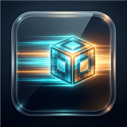 | **Motion Blur** | `motion-blur.hshader` | Плавное размытие в движении для Horizon 26.3 с адаптацией под 144 Гц и настройками силы и качества в игре. |
|  | **Fullbright** | `fullbright.hshader` | Максимальная яркость в пещерах, под водой и ночью без факелов и зелий с сохранением объёма блоков. |
|  | **Vibrant Vanilla+** | `vibrant-vanilla.hshader` | Сочные краски, тёплый солнечный свет на гранях блоков, мягкий контраст и ACES-цветокоррекция без потери FPS. |
|  | **Dynamic Colored Lights** | `colored-lights.hshader` | Реалистичное цветное 3D-освещение от факелов, душ, редстоуна, лавы, аметистов, порталов и морских фонарей. |
|  | **Realistic Water & Reflections** | `water-reflections.hshader` | Зеркальные отражения мира в воде, живые процедурные волны с бликами солнца и чистая глубина водоёмов. |
|  | **Real Shadows Lite** | `real-shadows-lite.hshader` | Мягкие динамические тени от солнца и луны с цветными тенями от витражей, оптимизированные под высокий FPS. |
|  | **Horizon Ultra** | `horizon-ultra.hshader` | Флагманский комбо-шейдер: мягкие тени, зеркальная вода, цветной 3D-свет, атмосферное небо, Bloom и Motion Blur. |
|  | **FPS Sharpness (CAS)** | `fps-sharpness.hshader` | Адаптивная чёткость AMD CAS — убирает «мыло» с текстур вдали без ореолов и практически с 0% нагрузки на видеокарту. |
|  | **Crystal Underwater** | `crystal-underwater.hshader` | Кристально чистая видимость под водой без мутного тумана + красивые солнечные каустики на морском дне. |
|  | **Clear Nether & End** | `clear-nether-end.hshader` | Полностью убирает густой туман в Незере и Энде и слегка подсвечивает тёмные своды для отличного обзора. |
| 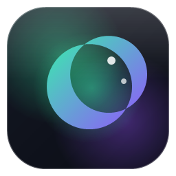 | **Aurora & Starry Sky** | `aurora-starry-sky.hshader` | Переливающееся северное сияние и яркая россыпь звёзд с Млечным Путём на ночном небе. |
|  | **Golden Sunset** | `golden-sunset.hshader` | Тёплая кинематографическая атмосфера золотого часа, янтарное свечение солнца, мягкая виньетка и плёночный тон. |
|  | **Cinematic Bloom** | `cinematic-bloom.hshader` | Мягкое кинематографическое свечение ярких источников света — факелов, лавы, порталов, маяков и солнца. |
|  | **Anime Cel-Shading** | `anime-cel-shading.hshader` | Мультяшный стиль в духе аниме и Borderlands: чёткая контурная обводка граней по глубине и ступенчатый свет. |
|  | **Retro PS1 / CRT** | `retro-ps1-crt.hshader` | Атмосфера консолей 90-х: пикселизация, дизеринг палитры 15-bit и мягкие CRT-сканлайны кинескопа. |
| 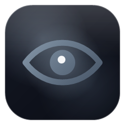 | **Horror Fog** | `horror-fog.hshader` | Густой холодный туман как в Silent Hill, приглушённые мрачные тона, плёночное зерно и плотная виньетка. |
|  | **Cyberpunk Neon** | `cyberpunk-neon.hshader` | Неоновый киберпанк-стиль: бирюзово-пурпурное освещение, яркие светящиеся блоки и лёгкая хроматическая аберрация. |
|  | **No Fog** | `no-fog.hshader` | Полностью отключает любой туман в Обычном мире, Незере, Энде, под водой и в дождь для 100% видимости вдаль. |
|  | **True Darkness** | `true-darkness.hshader` | Хардкорная реалистичная темнота в пещерах и безлунной ночью — без факела в шахте действительно ничего не видно. |
|  | **Warm Cozy Torchlight** | `warm-torchlight.hshader` | Уютный тёплый янтарный свет от факелов, костров и фонарей с мягким живым мерцанием пламени. |
|  | **Noir Black & White** | `noir-bw.hshader` | Контрастный чёрно-белый фильтр в стиле классического нуар-кино с опцией сохранения ярко-красных акцентов (Sin City). |
| 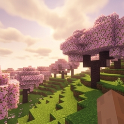 | **Pastel Dream** | `pastel-dream.hshader` | Мягкая сказочная пастельная цветовая гамма, осветлённые кремовые тени и нежное розово-лавандовое небо. |
|  | **Night Vision & Thermal** | `night-vision-thermal.hshader` | Тактический ПНВ и тепловизор (переключается одной галочкой в настройках шейдера: зелёный ПНВ или ИК-спектр). |
|  | **Depth of Field** | `depth-of-field.hshader` | Кинематографическое размытие фона (боке) с плавным автофокусом по центру прицела. |
|  | **Heat Haze** | `heat-haze.hshader` | Реалистичное марево раскалённого воздуха в пустынях, саваннах, бесплодных землях и в Незере. |
| 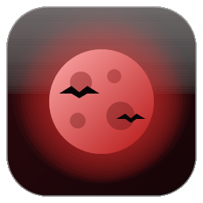 | **Blood Moon** | `blood-moon.hshader` | Багровое ночное небо, кроваво-красный ореол вокруг луны и зловещее алое освещение по ночам. |
|  | **PvP Boost Minimal** | `pvp-boost-minimal.hshader` | Киберспортивный PvP-шейдер: мягкий Fullbright, чёткость CAS, отключённый туман и сочный контраст с нулевой потерей FPS. |

## Ресурс-паки с Modrinth (1298 шт. — топ-100 показаны ниже, все 1298 доступны в лаунчере и `catalog.json`)

| Иконка | Название | Modrinth | Описание |
| :---: | :--- | :--- | :--- |
|  | **Low On Fire** | [low-on-fire](https://modrinth.com/resourcepack/low-on-fire) | Опускает пламя огня вниз экрана при горении в ванильном стиле — не закрывает обзор в PvP (18M+ скачиваний на Modrinth). |
|  | **Mandala's GUI - Dark mode** | [mandalas-gui-dark-mode](https://modrinth.com/resourcepack/mandalas-gui-dark-mode) | Элегантный тёмный интерфейс для инвентаря, сундуков, верстака и всех меню Minecraft без изменения блоков (7.5M+ скачиваний). |
|  | **Low Shield** | [low-shield-pack](https://modrinth.com/resourcepack/low-shield-pack) | Опускает щит ниже в руке, чтобы он не перекрывал противника и прицел во время боя (6M+ скачиваний). |
|  | **Enhanced Boss Bars** | [enhanced-boss-bars](https://modrinth.com/resourcepack/enhanced-boss-bars) | Стильные детализированные полоски здоровья боссов для Дракона Края, Визера и рейдов (5.5M+ скачиваний). |
|  | **Spunky PVP Texture Pack** | [spunky-pvp-texture-pack](https://modrinth.com/resourcepack/spunky-pvp-texture-pack) | Популярный PvP-пак от Spunky Insaan: короткие мечи, низкий огонь и чистые текстуры для дуэлей и SMP (2.2M+ скачиваний). |
|  | **Small Shield & Totem** | [small-shield-totem](https://modrinth.com/resourcepack/small-shield-totem) | Компактные щит и тотем бессмертия в руке + уменьшенная анимация срабатывания тотема (1.9M+ скачиваний). |
|  | **Dungeons Crit Sound** | [dungeons-crit-sound](https://modrinth.com/resourcepack/dungeons-crit-sound) | Заменяет стандартный звук критического удара на сочный и отчётливый звук из Minecraft Dungeons (1.8M+ скачиваний). |
|  | **CPVP Essentials ( Crystal PvP )** | [crystal-pvp-lt3-essentials](https://modrinth.com/resourcepack/crystal-pvp-lt3-essentials) | Профессиональный пак для Crystal PvP с максимальной видимостью взрывов, чистым огнём и чёткими звуками (1.6M+ скачиваний). |
|  | **Teddy Totems** | [teddy](https://modrinth.com/resourcepack/teddy) | Заменяет тотем бессмертия в левой руке на аккуратного плюшевого мишку, который не мешает обзору (1.5M+ скачиваний). |
|  | **PvP Crosshair** | [pvp-crosshair](https://modrinth.com/resourcepack/pvp-crosshair) | Чёткий минималистичный киберспортивный прицел для точной наводки в PvP (1.5M+ скачиваний). |
|  | **No Pumpkin Blur** | [no-pumpkin-blur](https://modrinth.com/resourcepack/no-pumpkin-blur) | Полностью убирает тёмную маску вырезанной тыквы с экрана для комфортных походов в Энд (1.3M+ скачиваний). |
| 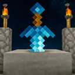 | **defrosted** | [defrosted_pack](https://modrinth.com/resourcepack/defrosted_pack) | Чистый, лёгкий и стильный PvP-пак 16x в ледяной палитре с аккуратным оружием и блоками (1.3M+ скачиваний). |
|  | **Mini Items** | [mini-items-pack](https://modrinth.com/resourcepack/mini-items-pack) | Уменьшает предметы в руке вдвое, освобождая максимум места на экране во время PvP (1M+ скачиваний). |
|  | **Aimz Better Crosshair** | [aimz-better-crosshair](https://modrinth.com/resourcepack/aimz-better-crosshair) | Современный контрастный прицел, улучшающий стандартный крестик по центру экрана (930K+ скачиваний). |
|  | **PvP Swords** | [short-pvp-swords](https://modrinth.com/resourcepack/short-pvp-swords) | Укороченные мечи всех тиров в чистом ванильном стиле для удобного обзора в бою (880K+ скачиваний). |
|  | **Fresh Weapons & Tools** | [fresh-weapons-and-tools](https://modrinth.com/resourcepack/fresh-weapons-and-tools) | Обновлённые детализированные ванильные мечи, топоры, кирки и инструменты с уникальным дизайном (720K+ скачиваний). |
|  | **small totem pop** | [small-totem-pop](https://modrinth.com/resourcepack/small-totem-pop) | Уменьшает всплывающую анимацию срабатывания тотема бессмертия, чтобы не перекрывать экран в бою (690K+ скачиваний). |
|  | **Transparent GUI and HUD** | [transparent-gui-and-hud](https://modrinth.com/resourcepack/transparent-gui-and-hud) | Прозрачные меню инвентаря, сундуков и HUD — сквозь открытый инвентарь всегда видно врагов (650K+ скачиваний). |
|  | **Mace Fusion** | [mace-fusion](https://modrinth.com/resourcepack/mace-fusion) | Проработанная 3D-модель булавы (Mace) с чистыми пропорциями в ванильном стиле (640K+ скачиваний). |
|  | **Reimagined GUI (Dark)** | [reimaginedguidark](https://modrinth.com/resourcepack/reimaginedguidark) | Современная тёмная переработка всех окон, кнопок и контейнеров Minecraft (630K+ скачиваний). |
|  | **No Enchant Glint** | [no-enchant-glint](https://modrinth.com/resourcepack/no-enchant-glint) | Убирает фиолетовый перелив зачарования с брони и оружия для чистого вида и плавного FPS (620K+ скачиваний). |
|  | **SenpaiSpider 1 Million Texture Pack** | [senpaispider-1-million-texture-pack](https://modrinth.com/resourcepack/senpaispider-1-million-texture-pack) | Знаменитый турнирный PvP-текстурпак от SenpaiSpider для дуэлей, Sword и SMP PvP (570K+ скачиваний). |
|  | **Animated Totem of Undying** | [animated-totem-of-undying](https://modrinth.com/resourcepack/animated-totem-of-undying) | Добавляет живую анимацию светящихся глаз у тотема бессмертия в руке (560K+ скачиваний). |
| 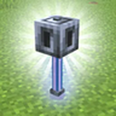 | **Amazing Mace 3d** | [amazing-mace-3d](https://modrinth.com/resourcepack/amazing-mace-3d) | Объёмная 3D-булава с выразительным силуэтом и детальной текстурой (530K+ скачиваний). |
| 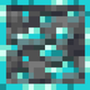 | **Outlined Ores** | [ore-outlines](https://modrinth.com/resourcepack/ore-outlines) | Яркие контурные рамки вокруг всех руд в шахтах и пещерах — работает на чистой ваниле без модов (520K+ скачиваний). |
| 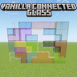 | **Vanilla Connected Glass** | [vanilla-connected-glass](https://modrinth.com/resourcepack/vanilla-connected-glass) | Чистое бесшовное стекло без лишних рамок, работающее без OptiFine и совместимое с другими паками (490K+ скачиваний). |
|  | **PVP SMP Deluxe** | [pvp-smp-deluxe](https://modrinth.com/resourcepack/pvp-smp-deluxe) | Сбалансированный ванильный PvP-пак для SMP: низкий огонь, низкий щит и аккуратное оружие (490K+ скачиваний). |
| 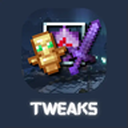 | **Crystal Vanilla Tweaks** | [crystal-vanilla-tweaks](https://modrinth.com/resourcepack/crystal-vanilla-tweaks) | Набор улучшений для Crystal PvP на базе ванилы: низкий огонь, меньше частиц и чистый обзор (485K+ скачиваний). |
|  | **Marlowww+** | [marlowww-plus](https://modrinth.com/resourcepack/marlowww-plus) | Легендарный минималистичный CPvP-пак Marlowww+ с фокусом на читаемость боя и высокий FPS (480K+ скачиваний). |
|  | **Simple Bedwars** | [simple-bedwars](https://modrinth.com/resourcepack/simple-bedwars) | Чистый и контрастный текстурпак для BedWars с аккуратной шерстью, блоками и оружием (190K+ скачиваний). |
|  | **Low Fire** | [low-fire-pack](https://modrinth.com/resourcepack/low-fire-pack) | Низкий огонь для чистого обзора в PvP (8.4M+ на Modrinth) — Lower your first-person fire to enhance visibility! |
|  | **Unique Dark** | [unique-dark](https://modrinth.com/resourcepack/unique-dark) | Тёмный/обновлённый интерфейс GUI и HUD (4.1M+ на Modrinth) — Dark GUI with unique textures for functional blocks. Dark mode for 80 mods |
|  | **Alacrity** | [alacrity](https://modrinth.com/resourcepack/alacrity) | Популярный PvP / Combat ресурс-пак с Modrinth (1.8M+ на Modrinth) — 32x resource pack with crazy attention to details |
|  | **AL's Dungeons Boss Bars** | [als-dungeons-boss-bars](https://modrinth.com/resourcepack/als-dungeons-boss-bars) | Стильные полоски здоровья боссов (1.7M+ на Modrinth) — A pack that makes the Boss Bars in the style of Minecraft Dungeons! |
| 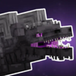 | **Boss Refreshed** | [boss-refreshed](https://modrinth.com/resourcepack/boss-refreshed) | Популярный PvP / Combat ресурс-пак с Modrinth (1.7M+ на Modrinth) — Minecraft's Bosses with a Refreshed Take! |
| 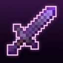 | **Enchantment Glows** | [enchantment-glows](https://modrinth.com/resourcepack/enchantment-glows) | Улучшенные эффекты и книги зачарований (1.5M+ на Modrinth) — Adds a glowing visual effect to enchanted tools |
| 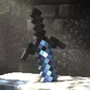 | **Excalibur** | [excal](https://modrinth.com/resourcepack/excal) | Популярный PvP / Combat ресурс-пак с Modrinth (933K+ на Modrinth) — Epic Medieval Fantasy |
|  | **Dark Smooth GUI** | [dark-smooth-gui](https://modrinth.com/resourcepack/dark-smooth-gui) | Тёмный/обновлённый интерфейс GUI и HUD (917K+ на Modrinth) — Adds a dark smooth GUI to Minecraft, with support for many mods GUIs |
| 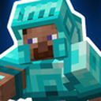 | **Armory Conglomery** | [armory-conglomery](https://modrinth.com/resourcepack/armory-conglomery) | Обновлённая броня и снаряжение (768K+ на Modrinth) — Armors with a Refreshed Take! |
|  | **Visual Enchantments** | [visual-enchantments](https://modrinth.com/resourcepack/visual-enchantments) | Улучшенные эффекты и книги зачарований (692K+ на Modrinth) — A resourcepack that adds visual indicators to enchanted items |
|  | **STONEBORN UI Overhaul** | [stoneborn](https://modrinth.com/resourcepack/stoneborn) | Тёмный/обновлённый интерфейс GUI и HUD (641K+ на Modrinth) — STONEBORN is a simple and unique UI overhaul inspired by fantasy media. |
|  | **Low Fire 🔥** | [lower-fire](https://modrinth.com/resourcepack/lower-fire) | Низкий огонь для чистого обзора в PvP (606K+ на Modrinth) — reduces or lowers the Minecraft fire texture, to make it less obstructive. Includes new... |
|  | **Faithless** | [faithless](https://modrinth.com/resourcepack/faithless) | Тёмный/обновлённый интерфейс GUI и HUD (550K+ на Modrinth) — Faithful to vanilla, yet a complete overhaul! - Building, Redstone, Survival, PvP... All in... |
|  | **Colourful containers Dark Mode GUI** | [colourful-containers-dark-mode-gui](https://modrinth.com/resourcepack/colourful-containers-dark-mode-gui) | Тёмный/обновлённый интерфейс GUI и HUD (527K+ на Modrinth) — A container GUI replacement mod that hopes to match the menu to every one of Minecraft's... |
|  | **PvP Scroutopia** | [pvp](https://modrinth.com/resourcepack/pvp) | Crystal PvP пак (484K+ на Modrinth) — A Crystal PvP, Sword PvP and Axe PvP texture pack, which includes low fire, small items and... |
|  | **GUI Revision Dark** | [gui-revision-dark](https://modrinth.com/resourcepack/gui-revision-dark) | Тёмный/обновлённый интерфейс GUI и HUD (462K+ на Modrinth) — Revamps the vanilla GUI with a darker and cleaner look! (Mod support) |
|  | **Blades of Majestica** | [blades-of-majestica](https://modrinth.com/resourcepack/blades-of-majestica) | PvP-пак с укороченными/обновлёнными мечами (448K+ на Modrinth) — Pack that allows you to change boring minecraft swords into majestic fantasy weapons! |
| 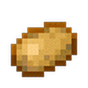 | **Potato Graphics** | [potato-graphics](https://modrinth.com/resourcepack/potato-graphics) | Лёгкий PvP-текстурпак с упором на FPS (444K+ на Modrinth) — Give your game a hilarious low-end makeover! This pack turns every block into a single... |
| 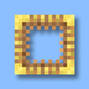 | **Better Scaffolding Visibility** | [better-scaffolding-visibility](https://modrinth.com/resourcepack/better-scaffolding-visibility) | Улучшенная видимость паутины/блоков в бою (436K+ на Modrinth) — Better Scaffolding removes the middle texture for better visibility. A simple resource pack... |
|  | **No Explosion Particles** | [no-explosion-particles](https://modrinth.com/resourcepack/no-explosion-particles) | Crystal PvP пак (424K+ на Modrinth) — This texture pack removes particles created by explosions. Immediately makes you better at... |
|  | **Quadral** | [quadral](https://modrinth.com/resourcepack/quadral) | Популярный PvP / Combat ресурс-пак с Modrinth (424K+ на Modrinth) — A bright, crisp design with vibrant colours. When you need a refreshing change from... |
| 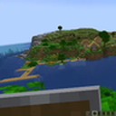 | **Low Shield PvP** | [low-shield-pvp](https://modrinth.com/resourcepack/low-shield-pvp) | Компактный/опущенный щит для PvP (411K+ на Modrinth) — This texture pack makes your shield lower so that you can PvP better. |
|  | **PvP Essentials** | [pvp-essentials](https://modrinth.com/resourcepack/pvp-essentials) | Низкий огонь для чистого обзора в PvP (397K+ на Modrinth) — Every Essential YOU Need For PvP! Includes No Bobber, No Fire, Low Shield, Small Totem Pop,... |
|  | **Spryzeen's Knight Armor** | [spryzeens-knight-armor](https://modrinth.com/resourcepack/spryzeens-knight-armor) | Обновлённая броня и снаряжение (375K+ на Modrinth) — Better armors, knight armors! |
|  | **Recolourful Containers GUI + HUD (DARK)** | [recolourful-containers-gui-hud-dark](https://modrinth.com/resourcepack/recolourful-containers-gui-hud-dark) | Тёмный/обновлённый интерфейс GUI и HUD (364K+ на Modrinth) — Do you want more immersive and more colourful GUIs and HUD? Than this pack is for you! NOW... |
|  | **(Bee's) Fine Armory** | [fine-armoury](https://modrinth.com/resourcepack/fine-armoury) | Обновлённая броня и снаряжение (333K+ на Modrinth) — My retextures of tools, weapons, and armour sets |
|  | **Mace 3D** | [mase-3d-by-nestter](https://modrinth.com/resourcepack/mase-3d-by-nestter) | 3D / PvP пак для булавы (Mace) (327K+ на Modrinth) — 3d model for the mace |
|  | **Wool Simple** | [simple-wool](https://modrinth.com/resourcepack/simple-wool) | PvP / BedWars пак (310K+ на Modrinth) — Simpler and better looking wool for bedwars and Minecraft. |
|  | **SMP Basics** | [smp-basics](https://modrinth.com/resourcepack/smp-basics) | Сбалансированный PvP-пак для SMP и дуэлей (305K+ на Modrinth) — The basics for SMP PvP! jump into your next pvp battle with SMP Basics for Survival... |
|  | **Crosshair TXF** | [crosshair-txf](https://modrinth.com/resourcepack/crosshair-txf) | Контрастный PvP-прицел (297K+ на Modrinth) — New design for minecraft crosshair |
| 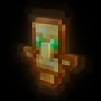 | **Smaller Totem** | [small-totem](https://modrinth.com/resourcepack/small-totem) | Компактный/улучшенный тотем бессмертия (294K+ на Modrinth) — Makes the totem smaller. |
|  | **FerreMcDurabilityOverlay** | [ferremcdurabilityoverlay](https://modrinth.com/resourcepack/ferremcdurabilityoverlay) | Обновлённая броня и снаряжение (280K+ на Modrinth) — This Pack shows the durability of armour. |
|  | **Mars's Enchanted Book Textures** | [different-textures-for-enchanted-books](https://modrinth.com/resourcepack/different-textures-for-enchanted-books) | Улучшенные эффекты и книги зачарований (279K+ на Modrinth) — Changes textures of enchanted books for better clarity |
| 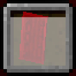 | **Visible Shield Cooldown** | [visible-shield-cooldown-rp](https://modrinth.com/resourcepack/visible-shield-cooldown-rp) | Компактный/опущенный щит для PvP (277K+ на Modrinth) — Shows you the status of your shield on cooldown (when it is disabled). Like the shield... |
| 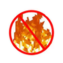 | **Fire remover (no fire)** | [no-fire](https://modrinth.com/resourcepack/no-fire) | Низкий огонь для чистого обзора в PvP (272K+ на Modrinth) — remove annoying fire |
|  | **SideShieldTexturePack** | [sideshieldpack](https://modrinth.com/resourcepack/sideshieldpack) | Компактный/опущенный щит для PvP (269K+ на Modrinth) — Side Shield And Small Blocking Texture Pack. |
|  | **Torturable Healthbars** | [torturable-healthbars](https://modrinth.com/resourcepack/torturable-healthbars) | Популярный PvP / Combat ресурс-пак с Modrinth (265K+ на Modrinth) — Instead of a health bar above the entity, health is shown as visual injuries on the mob |
| 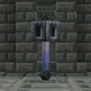 | **3D Mace!** | [3d-mace](https://modrinth.com/resourcepack/3d-mace) | 3D / PvP пак для булавы (Mace) (257K+ на Modrinth) — Simple 3D mace I made in my spare time. |
|  | **Detail Brush** | [detail-brush](https://modrinth.com/resourcepack/detail-brush) | Популярный PvP / Combat ресурс-пак с Modrinth (252K+ на Modrinth) — Polishes and redesigns a few items in Minecraft! |
| 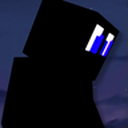 | **KingD3fault's [Fan Made]** | [kingd3faults](https://modrinth.com/resourcepack/kingd3faults) | Crystal PvP пак (250K+ на Modrinth) — A pack for KingD3fault (NOT OFFICIAL) for crystal pvp or cpvp |
|  | **Excalibur | Clarent Edition** | [clarent](https://modrinth.com/resourcepack/clarent) | Популярный PvP / Combat ресурс-пак с Modrinth (246K+ на Modrinth) — Clarent preserves the Excalibur experience by backporting features, fixing bugs, and... |
|  | **Nightmare Obsessed** | [nightmare-obsessed](https://modrinth.com/resourcepack/nightmare-obsessed) | Популярный PvP / Combat ресурс-пак с Modrinth (240K+ на Modrinth) — Reskins The Obsessed into a consistently creepy design, including adjusted animations and forms |
|  | **PvP Basics** | [pvp-basics](https://modrinth.com/resourcepack/pvp-basics) | Низкий огонь для чистого обзора в PvP (236K+ на Modrinth) — Purely vanilla, all-in-one PvP pack. Features: small fire and pop, and more! |
|  | **PvP Utils** | [pvp-utils](https://modrinth.com/resourcepack/pvp-utils) | Популярный PvP / Combat ресурс-пак с Modrinth (235K+ на Modrinth) — A texture pack, which adds Quality of Life Improvements for PvP, while keeping it in a... |
|  | **Crosshair v3** | [crosshair-v3](https://modrinth.com/resourcepack/crosshair-v3) | Контрастный PvP-прицел (225K+ на Modrinth) — Simple crosshair to enhance the PvP experience. |
|  | **Lower Shield** | [lower-shield](https://modrinth.com/resourcepack/lower-shield) | Компактный/опущенный щит для PvP (223K+ на Modrinth) — Decreases the amount of space the shield takes up on screen. |
|  | **Swight Texure Pack** | [axe-pvp-texure-pack](https://modrinth.com/resourcepack/axe-pvp-texure-pack) | PvP-пак с укороченными/обновлёнными мечами (221K+ на Modrinth) — A texure Pack for pvp, Reocommand for UHC, sword and Axe pvp! |
|  | **Stellarity Resource Pack** | [stellarity-rp](https://modrinth.com/resourcepack/stellarity-rp) | Популярный PvP / Combat ресурс-пак с Modrinth (218K+ на Modrinth) — Resource pack for Stellarity. Contains textures for all of its items, plus some other... |
|  | **Donut Smp Essentials** | [donut-smp-essentials](https://modrinth.com/resourcepack/donut-smp-essentials) | Сбалансированный PvP-пак для SMP и дуэлей (218K+ на Modrinth) — This texture pack has Donut Smp essentials which will help you raise your place on the... |
|  | **GUI Retextures** | [gui-retextures](https://modrinth.com/resourcepack/gui-retextures) | Тёмный/обновлённый интерфейс GUI и HUD (218K+ на Modrinth) — Makes GUI and HUD fancier - Dark mode, configurability with Respackopts |
|  | **ItzRealMe Edit** | [itzrealme-edit](https://modrinth.com/resourcepack/itzrealme-edit) | Популярный PvP / Combat ресурс-пак с Modrinth (214K+ на Modrinth) — An UNOFFICIAL ItzRealMe Texturepack |
|  | **PvP Haimiya Pack + Anime sky** | [pvp-haimiya-anime-pack](https://modrinth.com/resourcepack/pvp-haimiya-anime-pack) | Crystal PvP пак (211K+ на Modrinth) — The PvP/CPvP resource pack "Haimiya" adds a variety of textures, from the sky overlay to... |
| 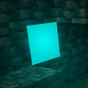 | **Ore Visible** | [ore.](https://modrinth.com/resourcepack/ore.) | Тёмный/обновлённый интерфейс GUI и HUD (205K+ на Modrinth) — A resource pack that makes spotting ores in dark caves much easier. |
| 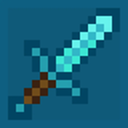 | **Short Swords** | [short-swords-pack](https://modrinth.com/resourcepack/short-swords-pack) | PvP-пак с укороченными/обновлёнными мечами (199K+ на Modrinth) — Experience a clearer view and smoother swings! |
|  | **Armors'N'Items - By StefanJ2** | [stefansarmorsnitems](https://modrinth.com/resourcepack/stefansarmorsnitems) | Тёмный/обновлённый интерфейс GUI и HUD (195K+ на Modrinth) — Adds a huge collection of custom items through anvil renaming, without any required mods. |
|  | **SMP PvP Essentials** | [smp-pvp-essentials](https://modrinth.com/resourcepack/smp-pvp-essentials) | Сбалансированный PvP-пак для SMP и дуэлей (191K+ на Modrinth) — This texture pack, SMP PvP Essentials, will help you climb the ranks in SMP! |
| 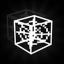 | **Cobweb Outline** | [cobweb-outline](https://modrinth.com/resourcepack/cobweb-outline) | Улучшенная видимость паутины/блоков в бою (173K+ на Modrinth) — Highlights cobwebs with a clean outline to improve visibility and control during PvP fights |
| 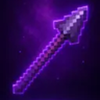 | **ArshuSmpOverlay(Spear&Mace)** | [pvp-texture-pack](https://modrinth.com/resourcepack/pvp-texture-pack) | 3D / PvP пак для булавы (Mace) (172K+ на Modrinth) — Best Smp & Pvps Overlay Pack. |
|  | **ItzRealMes Overlay** | [itzrealmes-overlay](https://modrinth.com/resourcepack/itzrealmes-overlay) | Crystal PvP пак (170K+ на Modrinth) — Crystal PvP Overlay to look like ItzRealMes. |
|  | **Simple PvP Edit** | [simple-pvp-edit](https://modrinth.com/resourcepack/simple-pvp-edit) | Популярный PvP / Combat ресурс-пак с Modrinth (169K+ на Modrinth) — This Minecraft Resource Pack enhances the aesthetics of PvP |
|  | **Smaller Totem** | [small-low-totem](https://modrinth.com/resourcepack/small-low-totem) | Компактный/улучшенный тотем бессмертия (169K+ на Modrinth) — Makes Totem smaller in size and low for better PvP. |
|  | **Marlowww Vanila PVP+** | [kreklinokpackpvp](https://modrinth.com/resourcepack/kreklinokpackpvp) | PvP-пак с укороченными/обновлёнными мечами (167K+ на Modrinth) — 1.4.2–26.3 | A clean PvP resource pack with short swords, smaller fire and improved item... |
| 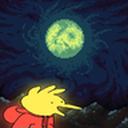 | **Tightfault Revamp Edit** | [tightfault-revamp-edit](https://modrinth.com/resourcepack/tightfault-revamp-edit) | Популярный PvP / Combat ресурс-пак с Modrinth (166K+ на Modrinth) — A small edit for the pack "Tightfault" for later versions of the game |
|  | **Small Items+** | [small.](https://modrinth.com/resourcepack/small.) | Низкий огонь для чистого обзора в PvP (165K+ на Modrinth) — low fire, small items, small totem, small totem pop, small shield, clear water,... |
|  | **PvP for Cuties** | [pvp-for-cuties](https://modrinth.com/resourcepack/pvp-for-cuties) | Популярный PvP / Combat ресурс-пак с Modrinth (163K+ на Modrinth) — A PvP Texturepack for Cuties by Cuties :3 |
|  | **Diamond SMP PVP default TexturePack** | [diamond-smp-pvp-default-texturepack](https://modrinth.com/resourcepack/diamond-smp-pvp-default-texturepack) | Сбалансированный PvP-пак для SMP и дуэлей (161K+ на Modrinth) — This is a texture pack for pvp. i have never really seen any default packs with all the... |
| 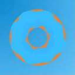 | **DrDonut's Fan Pack** | [drdonuts](https://modrinth.com/resourcepack/drdonuts) | Популярный PvP / Combat ресурс-пак с Modrinth (161K+ на Modrinth) — An UNOFFICIAL fan-made texturepack for DrDonut |
| 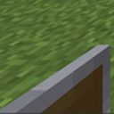 | **Smaller side shield** | [smaller-side-shield](https://modrinth.com/resourcepack/smaller-side-shield) | Компактный/опущенный щит для PvP (160K+ на Modrinth) — Side shield but smaller when blocking |
|  | **GUI** | [gui.](https://modrinth.com/resourcepack/gui.) | Тёмный/обновлённый интерфейс GUI и HUD (158K+ на Modrinth) — Fully black GUI for modern versions of Minecraft. |
| 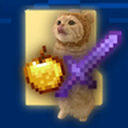 | **PvP Overlay** | [cattos-overlay](https://modrinth.com/resourcepack/cattos-overlay) | PvP-оверлей (совместим поверх других паков) (156K+ на Modrinth) — Overlay mainly focused on QoL features to help with Minecraft Combat |

*…и ещё **1198** проверенных ресурс-паков с Modrinth доступны напрямую во вкладке «Моды» лаунчера (см. [`catalog.json`](catalog.json)).*
