# Horizon Mods Catalog (26.3)

Официальный онлайн-каталог контентных `.hmod` модов, WGSL-шейдеров и PvP/QoL-паков для **Horizon Offline Launcher (Minecraft 26.3)**.

**Всего в каталоге: 68 дополнений** (12 настоящих `.hmod` модов с новыми предметами и блоками + 27 нативных `.hshader` WGSL-шейдеров + 29 клиентских `.zip` PvP/QoL-паков).

## Контентные моды Horizon (`.hmod` для `horizon-mods/`)

| Иконка | Название | Файл | Описание |
| :---: | :--- | :--- | :--- |
| 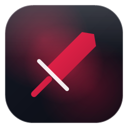 | **Ruby Arsenal** | `ruby-arsenal.hmod` | Добавляет рубин, рубиновый меч, топор, кирку, рубиновый блок и яркий рубиновый фонарь с крафтами. |
| 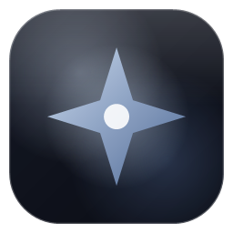 | **Ninja Shurikens** | `ninja-shurikens.hmod` | Оружие ниндзя: метательные железные и алмазные сюрикены, огненный кунай с реальным уроном и катана тени. |
| 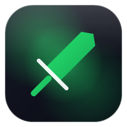 | **Emerald Gear** | `emerald-gear.hmod` | Полный набор изумрудного снаряжения (меч, кирка, топор) и светящийся изумрудный светильник. |
| 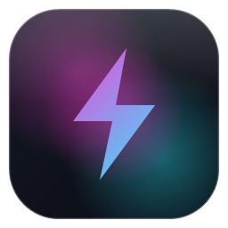 | **Neon Lamps** | `neon-lamps.hmod` | 8 ярких неоновых светильников (циан, маджента, лайм, янтарь, алый, фиолетовый, синий, ледяной) для декора баз. |
| 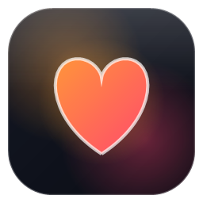 | **Super Foods** | `super-foods.hmod` | Новые питательные блюда и энергетики: Ягодный энергетик, Королевский стейк, Шоколадный маффин и Золотой эликсир. |
| 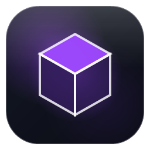 | **Obsidian Gear** | `obsidian-tools.hmod` | Сверхпрочное обсидиановое оружие, кирка, топор и укреплённый обсидиановый кирпич с огромной взрывоустойчивостью. |
| 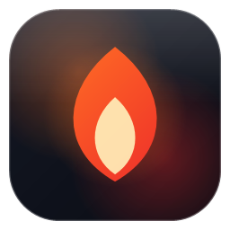 | **Battle Throwables** | `throwable-bombs.hmod` | Боевые метательные снаряды с уроном: метательный камень, магмовая сфера, ледяной осколок и эндер-кинжал. |
| 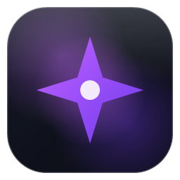 | **Amethyst Magic** | `amethyst-magic.hmod` | Аметистовая магия: кристальный клинок, метательный аметистовый заряд, аметистовое яблоко и светящийся кристалл. |
| 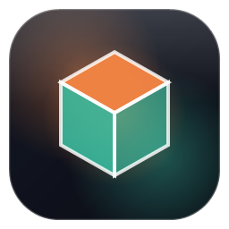 | **Copper Expansion** | `copper-plus.hmod` | Расширение меди: улучшенная медная кирка, боевой медный топор, энергоядро и светящийся медный блок. |
| 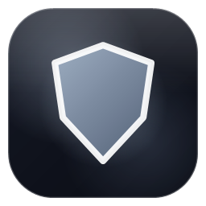 | **Reinforced Base** | `reinforced-base.hmod` | Блоки для неприступной базы: бронированный бетон, титановые плиты, защитное стекло и бункерная лампа. |
|  | **Frost Arsenal** | `ice-kingdom.hmod` | Ледяной арсенал: клинок мороза, ледяной топор, метательная ледяная звезда и светящийся кристальный лёд. |
| 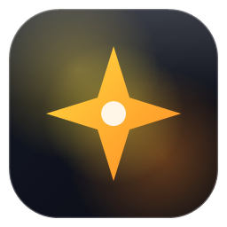 | **Golden Artifacts** | `golden-artifacts.hmod` | Золотые артефакты: позолоченный меч, священный метательный диск, солнечное яблоко и сияющий солнечный блок. |

## Нативные WGSL-шейдеры (`.hshader`)

| Иконка | Название | Файл | Описание |
| :---: | :--- | :--- | :--- |
|  | **Motion Blur** | `motion-blur.hshader` | Плавное размытие в движении для Horizon 26.3 с адаптацией под 144 Гц и настройками силы и качества в игре. |
| 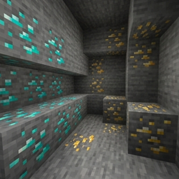 | **Fullbright** | `fullbright.hshader` | Максимальная яркость в пещерах, под водой и ночью без факелов и зелий с сохранением объёма блоков. |
|  | **Vibrant Vanilla+** | `vibrant-vanilla.hshader` | Сочные краски, тёплый солнечный свет на гранях блоков, мягкий контраст и ACES-цветокоррекция без потери FPS. |
|  | **Dynamic Colored Lights** | `colored-lights.hshader` | Реалистичное цветное 3D-освещение от факелов, душ, редстоуна, лавы, аметистов, порталов и морских фонарей. |
|  | **Realistic Water & Reflections** | `water-reflections.hshader` | Зеркальные отражения мира в воде, живые процедурные волны с бликами солнца и чистая глубина водоёмов. |
|  | **Real Shadows Lite** | `real-shadows-lite.hshader` | Мягкие динамические тени от солнца и луны с цветными тенями от витражей, оптимизированные под высокий FPS. |
|  | **Horizon Ultra** | `horizon-ultra.hshader` | Флагманский комбо-шейдер: мягкие тени, зеркальная вода, цветной 3D-свет, атмосферное небо, Bloom и Motion Blur. |
|  | **FPS Sharpness (CAS)** | `fps-sharpness.hshader` | Адаптивная чёткость AMD CAS — убирает «мыло» с текстур вдали без ореолов и практически с 0% нагрузки на видеокарту. |
|  | **Crystal Underwater** | `crystal-underwater.hshader` | Кристально чистая видимость под водой без мутного тумана + красивые солнечные каустики на морском дне. |
|  | **Clear Nether & End** | `clear-nether-end.hshader` | Полностью убирает густой туман в Незере и Энде и слегка подсвечивает тёмные своды для отличного обзора. |
|  | **Aurora & Starry Sky** | `aurora-starry-sky.hshader` | Переливающееся северное сияние и яркая россыпь звёзд с Млечным Путём на ночном небе. |
| 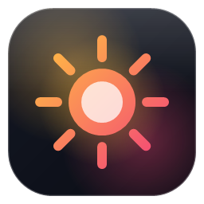 | **Golden Sunset** | `golden-sunset.hshader` | Тёплая кинематографическая атмосфера золотого часа, янтарное свечение солнца, мягкая виньетка и плёночный тон. |
|  | **Cinematic Bloom** | `cinematic-bloom.hshader` | Мягкое кинематографическое свечение ярких источников света — факелов, лавы, порталов, маяков и солнца. |
| 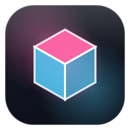 | **Anime Cel-Shading** | `anime-cel-shading.hshader` | Мультяшный стиль в духе аниме и Borderlands: чёткая контурная обводка граней по глубине и ступенчатый свет. |
| 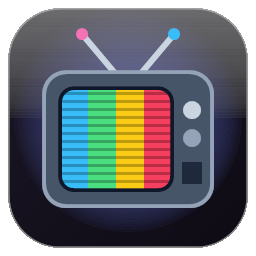 | **Retro PS1 / CRT** | `retro-ps1-crt.hshader` | Атмосфера консолей 90-х: пикселизация, дизеринг палитры 15-bit и мягкие CRT-сканлайны кинескопа. |
|  | **Horror Fog** | `horror-fog.hshader` | Густой холодный туман как в Silent Hill, приглушённые мрачные тона, плёночное зерно и плотная виньетка. |
|  | **Cyberpunk Neon** | `cyberpunk-neon.hshader` | Неоновый киберпанк-стиль: бирюзово-пурпурное освещение, яркие светящиеся блоки и лёгкая хроматическая аберрация. |
|  | **No Fog** | `no-fog.hshader` | Полностью отключает любой туман в Обычном мире, Незере, Энде, под водой и в дождь для 100% видимости вдаль. |
| 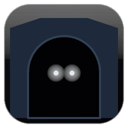 | **True Darkness** | `true-darkness.hshader` | Хардкорная реалистичная темнота в пещерах и безлунной ночью — без факела в шахте действительно ничего не видно. |
|  | **Warm Cozy Torchlight** | `warm-torchlight.hshader` | Уютный тёплый янтарный свет от факелов, костров и фонарей с мягким живым мерцанием пламени. |
| 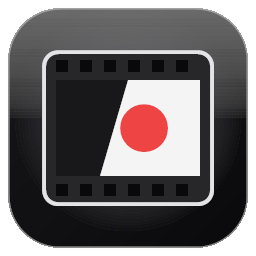 | **Noir Black & White** | `noir-bw.hshader` | Контрастный чёрно-белый фильтр в стиле классического нуар-кино с опцией сохранения ярко-красных акцентов (Sin City). |
|  | **Pastel Dream** | `pastel-dream.hshader` | Мягкая сказочная пастельная цветовая гамма, осветлённые кремовые тени и нежное розово-лавандовое небо. |
|  | **Night Vision & Thermal** | `night-vision-thermal.hshader` | Тактический ПНВ и тепловизор (переключается одной галочкой в настройках шейдера: зелёный ПНВ или ИК-спектр). |
|  | **Depth of Field** | `depth-of-field.hshader` | Кинематографическое размытие фона (боке) с плавным автофокусом по центру прицела. |
|  | **Heat Haze** | `heat-haze.hshader` | Реалистичное марево раскалённого воздуха в пустынях, саваннах, бесплодных землях и в Незере. |
|  | **Blood Moon** | `blood-moon.hshader` | Багровое ночное небо, кроваво-красный ореол вокруг луны и зловещее алое освещение по ночам. |
| 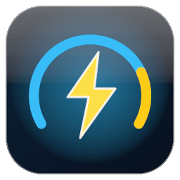 | **PvP Boost Minimal** | `pvp-boost-minimal.hshader` | Киберспортивный PvP-шейдер: мягкий Fullbright, чёткость CAS, отключённый туман и сочный контраст с нулевой потерей FPS. |

## Клиентские PvP и QoL паки (`.zip` для `resourcepacks/`)

| Иконка | Название | Файл | Описание |
| :---: | :--- | :--- | :--- |
| 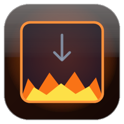 | **Low Fire** | `low-fire.zip` | Опускает пламя огня вниз экрана при горении, чтобы оно не закрывало обзор в PvP и Незере. |
| 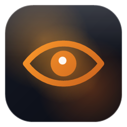 | **No Pumpkin Blur** | `no-pumpkin-blur.zip` | Полностью убирает тёмную маску вырезанной тыквы с экрана для комфортных походов в Энд. |
| 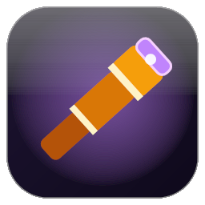 | **Clear Spyglass** | `clear-spyglass.zip` | Убирает чёрные поля подзорной трубы, оставляя полный широкоэкранный обзор при приближении. |
| 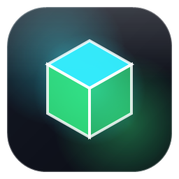 | **Outlined Ores** | `outlined-ores.zip` | Яркая цветная окантовка всех руд и древних обломков — мгновенно заметны в шахтах и пещерах. |
| 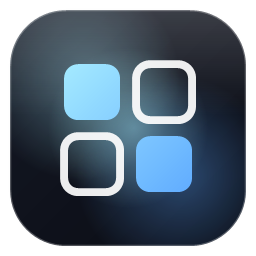 | **Clear Glass** | `clear-glass.zip` | Чистое прозрачное стекло и витражи с тонкой аккуратной рамкой без лишних бликов и полос. |
| 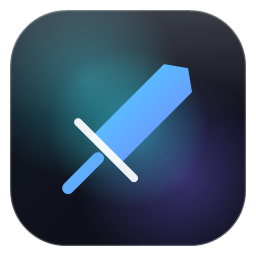 | **Short Swords** | `short-swords.zip` | Укороченные мечи всех тиров (включая медный и незеритовый) для чистого обзора в PvP. |
| 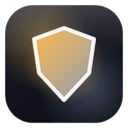 | **Low Shield** | `low-shield.zip` | Опускает щит ниже в руке (и в покое, и в блоке), чтобы он не перекрывал прицел и противника. |
| 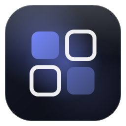 | **Dark Glass UI** | `dark-glass-ui.zip` | Тёмный полупрозрачный интерфейс инвентаря, сундуков, верстака и печей в стиле Liquid Glass. |
| 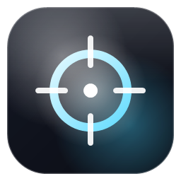 | **Clean PvP Crosshair** | `clean-pvp-crosshair.zip` | Аккуратный киберспортивный прицел с центральной точкой и зазором для точной наводки. |
| 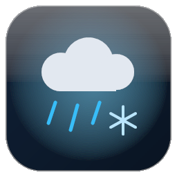 | **Minimal Weather** | `minimal-weather.zip` | Тонкие полупрозрачные капли дождя и снежинки — сохраняют атмосферу, но не мешают обзору. |
| 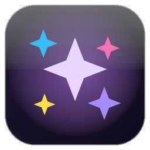 | **Clean Particles** | `clean-particles.zip` | Делает частицы взрывов, дыма и зелий компактными и полупрозрачными для чистого экрана в бою. |
| 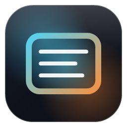 | **Cleaner Hotbar** | `cleaner-hotbar.zip` | Полупрозрачный тёмно-стеклянный хотбар с яркой неоново-оранжевой рамкой выбранного слота. |
| 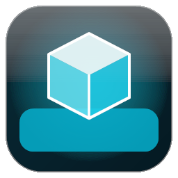 | **Bright Water & Ice** | `bright-water-ice.zip` | Кристально прозрачный лёд с аккуратной гранью и более чистая бирюзовая поверхность воды. |
| 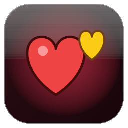 | **Crisp Hearts & Armor** | `compact-totem-hearts.zip` | Контрастные сочные иконки здоровья, золотых сердец и брони в HUD для мгновенного чтения ХП. |
| 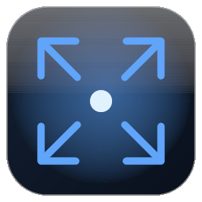 | **No Screen Borders** | `no-screen-borders.zip` | Убирает тёмную виньетку по углам экрана и ледяную корку от рыхлого снега. |
| 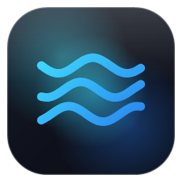 | **Clear Water Overlay** | `clear-water-overlay.zip` | Полностью убирает мутную текстуру воды с экрана при плавании под водой. |
| 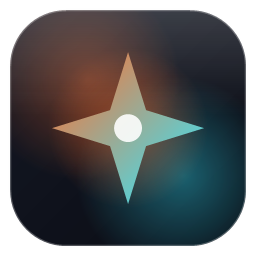 | **Bright Crit Particles** | `bright-crit-particles.zip` | Яркие контрастные звёзды критических ударов и ударов с Заговором/Остротой в PvP. |
| 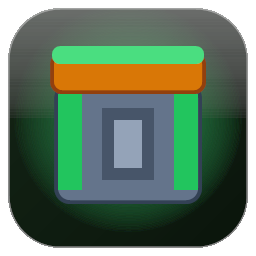 | **Sticky Piston Marker** | `sticky-piston-marker.zip` | Зелёная метка слизи по бокам липких поршней, чтобы сразу отличать их от обычных в механизмах. |
|  | **Redstone Clarity** | `redstone-clarity.zip` | Чёткие стрелки направления на Наблюдателях (Observer) и яркая индикация активных повторителей. |
| 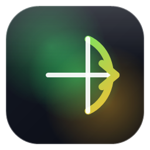 | **Bow Charge Indicator** | `bow-charge-indicator.zip` | Цветовая подсветка стадий натяжения лука (красный → жёлтый → ярко-зелёный при 100% заряде). |
| 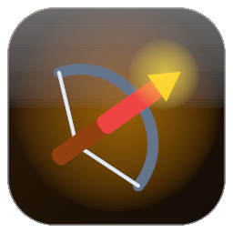 | **Crossbow Ready Glow** | `crossbow-ready-glow.zip` | Яркая индикация зарядки арбалета и подсветка заряженного снаряда (стрела / фейерверк). |
| 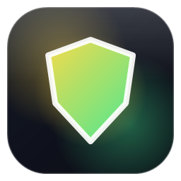 | **Small Totem** | `small-totem.zip` | Компактный тотем бессмертия в руке — занимает минимум места внизу экрана и не мешает в PvP. |
| 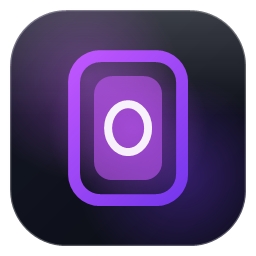 | **Clear Nether Portal** | `clear-nether-portal.zip` | Мягкая полупрозрачная плёнка портала в Незер — сквозь портал отлично видно другую сторону. |
| 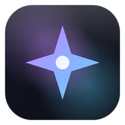 | **Clean Enchant Glint** | `clean-enchant-glint.zip` | Спокойный деликатный перелив зачарования, не скрывающий цвет брони и отделку кузнечных шаблонов. |
| 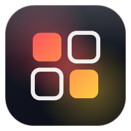 | **Better BedWars Wool** | `better-bedwars-wool.zip` | Гладкая сочная шерсть всех 16 цветов с чёткой рамкой граней — идеально для бриджинга и BedWars. |
| 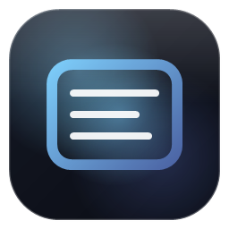 | **Transparent Inventory** | `transparent-inventory.zip` | Прозрачный инвентарь и сундуки — сквозь открытое меню всегда видно врагов и всё вокруг в PvP. |
| 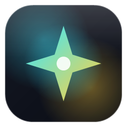 | **Small PvP Utilities** | `small-utilities.zip` | Компактные эндер-жемчуг, золотые яблоки и взрывные зелья в руке — не закрывают обзор во время боя. |
| 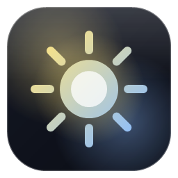 | **Clean Sun & Moon** | `clean-sky-celestials.zip` | Современное мягко сияющее круглое солнце и контрастная серебристая луна для чистого неба. |
| 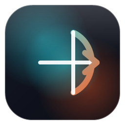 | **High-Vis Pearls & Arrows** | `high-vis-arrows.zip` | Неоново-бирюзовый эндер-жемчуг и ярко-огненные стрелы — отлично видны в полёте и в инвентаре. |
