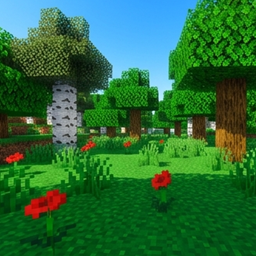
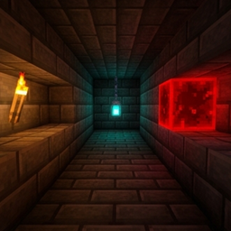
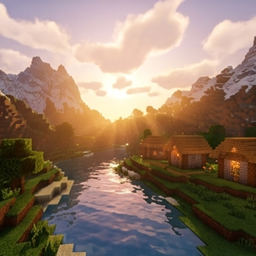
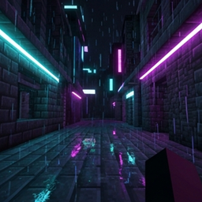
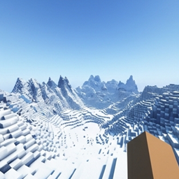
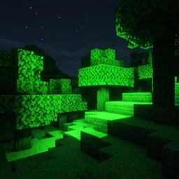
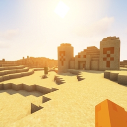

# Horizon Shaders Catalog (26.3)

Официальный онлайн-каталог нативных WGSL-шейдеров для **Horizon Offline Launcher (Minecraft 26.3)**.
Все шейдеры работают **на 100% на стороне клиента** — и в одиночном мире, и на любом сервере, с поддержкой объединения нескольких шейдеров одновременно.

**Всего в каталоге: 27 нативных `.hshader` WGSL-шейдеров.**

| Превью | Название | Файл | Описание |
| :---: | :--- | :--- | :--- |
|  | **Motion Blur** | `motion-blur.hshader` | Плавное размытие в движении для Horizon 26.3 с адаптацией под 144 Гц и настройками силы и качества в игре. |
|  | **Fullbright** | `fullbright.hshader` | Максимальная яркость в пещерах, под водой и ночью без факелов и зелий с сохранением объёма блоков. |
|  | **Vibrant Vanilla+** | `vibrant-vanilla.hshader` | Сочные краски, тёплый солнечный свет на гранях блоков, мягкий контраст и ACES-цветокоррекция без потери FPS. |
|  | **Dynamic Colored Lights** | `colored-lights.hshader` | Реалистичное цветное 3D-освещение от факелов, душ, редстоуна, лавы, аметистов, порталов и морских фонарей. |
|  | **Realistic Water & Reflections** | `water-reflections.hshader` | Зеркальные отражения мира в воде, живые процедурные волны с бликами солнца и чистая глубина водоёмов. |
|  | **Real Shadows Lite** | `real-shadows-lite.hshader` | Мягкие динамические тени от солнца и луны с цветными тенями от витражей, оптимизированные под высокий FPS. |
|  | **Horizon Ultra** | `horizon-ultra.hshader` | Флагманский комбо-шейдер: мягкие тени, зеркальная вода, цветной 3D-свет, атмосферное небо, Bloom и Motion Blur. |
|  | **FPS Sharpness (CAS)** | `fps-sharpness.hshader` | Адаптивная чёткость AMD CAS — убирает «мыло» с текстур вдали без ореолов и практически с 0% нагрузки на видеокарту. |
|  | **Crystal Underwater** | `crystal-underwater.hshader` | Кристально чистая видимость под водой без мутного тумана + красивые солнечные каустики на морском дне. |
|  | **Clear Nether & End** | `clear-nether-end.hshader` | Полностью убирает густой туман в Незере и Энде и слегка подсвечивает тёмные своды для отличного обзора. |
|  | **Aurora & Starry Sky** | `aurora-starry-sky.hshader` | Переливающееся северное сияние и яркая россыпь звёзд с Млечным Путём на ночном небе. |
|  | **Golden Sunset** | `golden-sunset.hshader` | Тёплая кинематографическая атмосфера золотого часа, янтарное свечение солнца, мягкая виньетка и плёночный тон. |
|  | **Cinematic Bloom** | `cinematic-bloom.hshader` | Мягкое кинематографическое свечение ярких источников света — факелов, лавы, порталов, маяков и солнца. |
|  | **Anime Cel-Shading** | `anime-cel-shading.hshader` | Мультяшный стиль в духе аниме и Borderlands: чёткая контурная обводка граней по глубине и ступенчатый свет. |
|  | **Retro PS1 / CRT** | `retro-ps1-crt.hshader` | Атмосфера консолей 90-х: пикселизация, дизеринг палитры 15-bit и мягкие CRT-сканлайны кинескопа. |
|  | **Horror Fog** | `horror-fog.hshader` | Густой холодный туман как в Silent Hill, приглушённые мрачные тона, плёночное зерно и плотная виньетка. |
|  | **Cyberpunk Neon** | `cyberpunk-neon.hshader` | Неоновый киберпанк-стиль: бирюзово-пурпурное освещение, яркие светящиеся блоки и лёгкая хроматическая аберрация. |
|  | **No Fog** | `no-fog.hshader` | Полностью отключает любой туман в Обычном мире, Незере, Энде, под водой и в дождь для 100% видимости вдаль. |
|  | **True Darkness** | `true-darkness.hshader` | Хардкорная реалистичная темнота в пещерах и безлунной ночью — без факела в шахте действительно ничего не видно. |
|  | **Warm Cozy Torchlight** | `warm-torchlight.hshader` | Уютный тёплый янтарный свет от факелов, костров и фонарей с мягким живым мерцанием пламени. |
|  | **Noir Black & White** | `noir-bw.hshader` | Контрастный чёрно-белый фильтр в стиле классического нуар-кино с опцией сохранения ярко-красных акцентов (Sin City). |
|  | **Pastel Dream** | `pastel-dream.hshader` | Мягкая сказочная пастельная цветовая гамма, осветлённые кремовые тени и нежное розово-лавандовое небо. |
|  | **Night Vision & Thermal** | `night-vision-thermal.hshader` | Тактический ПНВ и тепловизор (переключается одной галочкой в настройках шейдера: зелёный ПНВ или ИК-спектр). |
|  | **Depth of Field** | `depth-of-field.hshader` | Кинематографическое размытие фона (боке) с плавным автофокусом по центру прицела. |
|  | **Heat Haze** | `heat-haze.hshader` | Реалистичное марево раскалённого воздуха в пустынях, саваннах, бесплодных землях и в Незере. |
|  | **Blood Moon** | `blood-moon.hshader` | Багровое ночное небо, кроваво-красный ореол вокруг луны и зловещее алое освещение по ночам. |
|  | **PvP Boost Minimal** | `pvp-boost-minimal.hshader` | Киберспортивный PvP-шейдер: мягкий Fullbright, чёткость CAS, отключённый туман и сочный контраст с нулевой потерей FPS. |
